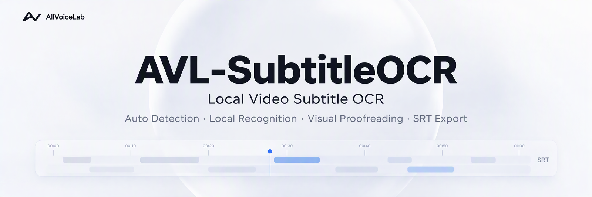

<p align="center">
  
</p>

<h1 align="center">AVL-SubtitleOCR Build Guide</h1>

<p align="center">
  <a href="BUILDING.md"></a>
  <a href="BUILDING.en.md"></a>
</p>

<p align="center">Set up your environment, run the source, and build your Windows application.</p>

<p align="center">
  <a href="#prerequisites">Prerequisites</a> · <a href="#quick-build">Quick build</a> · <a href="#development-setup">Development</a> · <a href="#troubleshooting">Troubleshooting</a> · <a href="README.en.md">Project overview</a>
</p>

This guide targets **Windows 10/11 x64**, covering source setup, backend rebuilds, and Windows release packaging.

| What you want to do | Start here |
| --- | --- |
| Build Setup / Portable applications from source | [Quick build](#quick-build) |
| Set up development and start the desktop UI | [Development setup](#development-setup) |
| Rebuild Python changes, check the backend, or remove artifacts | [Rebuilding and verification](#rebuilding-and-verification) |
| Find source directories and bundled models | [Repository layout and models](#repository-layout-and-models) |
| Resolve environment or packaging issues | [Troubleshooting](#troubleshooting) |

## Prerequisites

| Requirement | Version / notes |
| --- | --- |
| Operating system | Windows 10 or Windows 11, 64-bit |
| Python | 3.12 or newer; the recorded release environment uses CPython 3.14.6 (Windows x64) |
| Node.js | 18 or newer, including `npm` |
| Git | Any recent version |
| Network | Required for the first `pip install`, `npm install`, and Electron download |
| Disk space | Several GB free for the virtual environment, Node modules, and release artifacts |

The pinned [NumPy 2.5.2](https://pypi.org/project/numpy/2.5.2/) requires Python 3.12+, so the former 3.10+ requirement is insufficient. Prefer the recorded release environment above; other interpreter versions also depend on compatible Windows x64 packages being available for all pinned dependencies.

Run commands in PowerShell from the repository root unless a step says otherwise. Command Prompt alternatives are marked separately.

## Quick build

A fresh clone can be packaged with one command:

```powershell
git clone https://github.com/allvoicelab/AVL-SubtitleOCR.git
cd AVL-SubtitleOCR
.\build_app_windows.bat
```

For a fresh clone, the script performs the steps below. Later runs reuse an existing backend bundle and frontend dependencies:

1. Creates `.venv` and installs the pinned Python dependencies from `requirements.txt`.
2. Installs the local `avl-open` package in editable mode.
3. Builds `dist\SubtitleSidecar\SubtitleSidecar.exe` with PyInstaller.
4. Verifies that the OCR models, third-party license bundle, and protocol handshake are present.
5. Runs `npm install` in `frontend/` when needed.
6. Packages the Electron application with electron-builder.

The resulting files are written to `frontend/release/`:

- `AVL-SubtitleOCR-Setup-<version>.exe`
- `AVL-SubtitleOCR-Portable-<version>.exe`

The version comes from the `version` field in `frontend/package.json`.

**One run is enough.** You do not need to run the build twice. The backend build and the Electron packaging are both handled by `build_app_windows.bat`.

## Development setup

<details>
<summary>First-time setup: install Python, Node.js, and npm (skip if already installed)</summary>

### Install development tools

#### Install Python

Install Python 3.12 or newer. On Windows, download the installer from the
[Python website](https://www.python.org/downloads/windows/) and select
**Add Python to PATH** during installation.

Open a new terminal after installation and verify:

```powershell
python --version
```

#### Install Node.js and npm

`npm` is installed together with Node.js; there is no separate npm installer.
Download the Windows x64 **LTS** installer from the
[Node.js website](https://nodejs.org/en/download) and use the default options.
Alternatively, install it with `winget`:

```powershell
winget install --id OpenJS.NodeJS.LTS -e
```

Open a new terminal after installation and verify both commands:

```powershell
node --version
npm.cmd --version
```

If both commands print a version number, the installation is complete. If
PowerShell blocks `npm.ps1`, use `npm.cmd` as shown in the remaining commands
in this guide.

If a command is not found, reopen the terminal first. If it still fails, make
sure the Node.js installation directory is on the system `PATH`, or rerun the
installer and choose the repair option.

</details>

### 1. Prepare the Python environment

From the repository root:

```powershell
python -m venv .venv
.\.venv\Scripts\Activate.ps1
python -m pip install --upgrade pip
python -m pip install -r requirements.txt
python -m pip install -e avl-open
```

If PowerShell blocks script execution, use Command Prompt instead:

```bat
python -m venv .venv
.venv\Scripts\activate.bat
python -m pip install --upgrade pip
python -m pip install -r requirements.txt
python -m pip install -e avl-open
```

### 2. Build the backend (optional)

For source development, skip to step 3 to run the Python backend from your active virtual environment. Use this step to verify the packaged backend or prepare a release.

```powershell
.\build_sidecar_windows.bat
```

This produces the self-contained backend at:

```text
dist\SubtitleSidecar\SubtitleSidecar.exe
```

The build script refuses to continue if the required ONNX models or the third-party license bundle are missing. It also checks that the packaged sidecar answers the JSON protocol handshake.

### 3. Start the desktop UI

```powershell
cd frontend
npm.cmd install
npm.cmd start
```

During development, Electron uses the backend in this order:

1. A path supplied through the `SUBTITLE_SIDECAR` environment variable.
2. `dist\SubtitleSidecar\SubtitleSidecar.exe` from the checkout.
3. `python -m sidecar --protocol-version 1` from the active Python environment.

The fallback means you can work on the UI without packaging, provided the Python dependencies are installed and the virtual environment is active.

## Rebuilding and Verification

Run these commands from the repository root. After the UI startup steps above, close the app and run `cd ..` from `frontend/` to return to the root. Choose the operation you need.

### Building only the backend

If you changed Python code under `sidecar/`, `app/`, or `avl-open/`, rebuild the backend before packaging:

```powershell
Remove-Item -Recurse -Force dist\SubtitleSidecar, build\SubtitleSidecar
.\build_sidecar_windows.bat
```

Close any running copy of `AVL-SubtitleOCR.exe` and `SubtitleSidecar.exe` first. Windows cannot replace DLLs that are still in use.

`frontend\build_app_windows.bat` skips the backend build when `dist\SubtitleSidecar\SubtitleSidecar.exe` already exists. Delete the two directories above whenever you need a clean Python rebuild.

### Verify the backend

The build script runs smoke checks automatically. You can also test the protocol directly:

```powershell
'{"id":1,"method":"system.ping"}' | .\dist\SubtitleSidecar\SubtitleSidecar.exe
```

The process should return a `system.hello` response and a `pong` result.

### Clean build

To remove generated artifacts and rebuild from scratch:

```powershell
Remove-Item -Recurse -Force dist, build, frontend\release, frontend\build-sidecar
Remove-Item -Recurse -Force frontend\node_modules
.\build_app_windows.bat
```

This removes `frontend/node_modules/`, so the next build must reinstall frontend dependencies and may need network access. The Electron download cache outside the repository is not removed.

## Repository Layout and Models

| Path | Purpose |
| --- | --- |
| `frontend/` | Electron main process and renderer UI |
| `sidecar/` | Local Python backend started by Electron |
| `app/` | OCR adapter and SRT formatting shared by the sidecar |
| `avl-open/` | OCR algorithms, ONNX models, and model dictionaries |
| `dist/SubtitleSidecar/` | Generated backend bundle; not tracked |
| `frontend/release/` | Generated Windows installers; not tracked |
| `licenses/` | Optional local license bundle; generated automatically during the build when absent |

### Bundled models

The runtime model files are tracked in the repository:

```text
avl-open/avl_open_ocr/model_files/
  res18-db-damo_mixed.onnx
  paddle_v6_rec_small.onnx
  paddle_v6_dict.txt
  korean_PP-OCRv5_mobile_rec.onnx
  korean_v5_dict.txt
```

> The public repository tracks the runtime source code, public documentation, and the OCR model files required at runtime. Generated artifacts and maintainer-only tooling are not tracked.

## Troubleshooting

<details>
<summary>python is not found</summary>

Install Python 3.12 or newer and enable **Add Python to PATH** during installation. The build scripts also try `python3` when `python` is unavailable.

</details>

<details>
<summary>npm is not found</summary>

Install Node.js 18 or newer and reopen the terminal so that `PATH` is updated.

</details>

<details>
<summary>SubtitleSidecar.exe is still running</summary>

Close AVL-SubtitleOCR and any manually started sidecar process, then retry. You can check with:

```powershell
Get-Process SubtitleSidecar -ErrorAction SilentlyContinue
```

</details>

<details>
<summary>The backend still behaves like an older build</summary>

The frontend build reuses an existing backend bundle. Remove it and rebuild:

```powershell
Remove-Item -Recurse -Force dist\SubtitleSidecar, build\SubtitleSidecar
.\build_app_windows.bat
```

</details>

<details>
<summary>Missing models or license files</summary>

Do not create empty placeholder files. For models, restore the tracked files under `avl-open/avl_open_ocr/model_files/` from a fresh clone. For licenses, rerun the sidecar build with the virtual environment active so that `tools/collect_licenses.py` can inspect the installed packages.

</details>

<details>
<summary>--allow-no-preview</summary>

`build_sidecar_windows.bat --allow-no-preview` is for diagnostics only: it lets packaging continue after the PyAV/Pillow import check fails. It does not skip their installation from `requirements.txt` or bypass dependency installation failures. Missing components can disable preview preparation or still-frame decoding. Normal releases should use the default build.

</details>

---

[Back to project overview](README.en.md) · [User guide](docs/USER_GUIDE.en.md) · [简体中文指南](BUILDING.md) · [Back to top](#avl-subtitleocr-build-guide)
