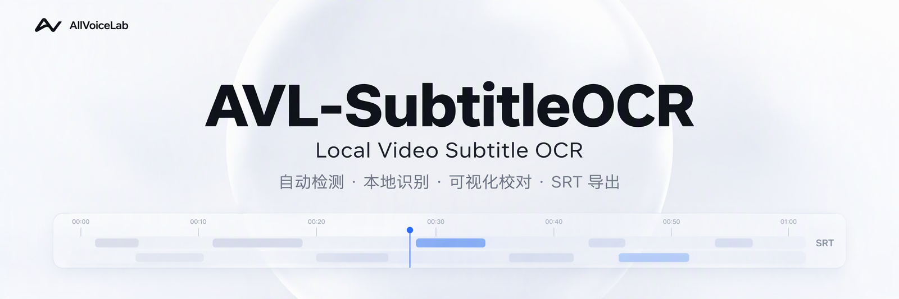

<p align="center">
  
</p>

<h1 align="center">AVL-SubtitleOCR 构建指南</h1>

<p align="center">
  <a href="BUILDING.md"></a>
  <a href="BUILDING.en.md"></a>
</p>

<p align="center">准备环境、运行源码，构建自己的 Windows 应用。</p>

<p align="center">
  <a href="#环境要求">环境要求</a> · <a href="#快速构建">快速构建</a> · <a href="#开发环境">开发环境</a> · <a href="#常见问题">常见问题</a> · <a href="README.md">项目介绍</a>
</p>

本文面向 **Windows 10/11 x64**，包含源码运行、后端重建和 Windows 发布包的构建步骤。

| 你想完成的事情 | 阅读入口 |
| --- | --- |
| 从源码生成 Setup / Portable 应用 | [快速构建](#快速构建) |
| 配置开发环境，启动桌面界面 | [开发环境](#开发环境) |
| 修改 Python 代码后重建、检查后端或清理产物 | [重建与验证](#重建与验证) |
| 查找源码目录和内置模型 | [仓库结构与模型](#仓库结构与模型) |
| 排查环境或打包问题 | [常见问题](#常见问题) |

## 环境要求

| 项目 | 版本 / 说明 |
| --- | --- |
| 操作系统 | Windows 10 或 Windows 11，64 位 |
| Python | 3.12 或更高版本；发布构建记录使用 CPython 3.14.6（Windows x64） |
| Node.js | 18 或更高版本，包含 `npm` |
| Git | 任意较新版本 |
| 网络 | 首次执行 `pip install`、`npm install` 和下载 Electron 时需要 |
| 磁盘空间 | 需要数 GB 空间，用于虚拟环境、Node 模块和发布产物 |

当前固定依赖中的 [NumPy 2.5.2](https://pypi.org/project/numpy/2.5.2/) 要求 Python 3.12+，不能按旧的 3.10+ 要求安装。建议优先使用上表记录的发布构建环境；其他解释器版本是否可用，还取决于固定依赖是否提供兼容的 Windows x64 包。

除非某一步特别说明，以下命令都在仓库根目录的 PowerShell 中执行；命令提示符替代步骤会单独标出。

## 快速构建

全新克隆的仓库可以用一条命令完成打包：

```powershell
git clone https://github.com/allvoicelab/AVL-SubtitleOCR.git
cd AVL-SubtitleOCR
.\build_app_windows.bat
```

全新克隆时，脚本会执行以下步骤；后续运行会复用已有后端和前端依赖：

1. 创建 `.venv`，并安装 `requirements.txt` 中固定版本的 Python 依赖。
2. 以 editable 模式安装仓库内的 `avl-open`。
3. 使用 PyInstaller 构建 `dist\SubtitleSidecar\SubtitleSidecar.exe`。
4. 校验 OCR 模型、第三方许可和协议握手是否齐全。
5. 在需要时进入 `frontend/` 执行 `npm install`。
6. 使用 electron-builder 打包 Electron 应用。

产物写入 `frontend/release/`：

- `AVL-SubtitleOCR-Setup-<version>.exe`
- `AVL-SubtitleOCR-Portable-<version>.exe`

版本号来自 `frontend/package.json` 的 `version` 字段。

**只需运行一次。** 不需要重复打包；`build_app_windows.bat` 会同时处理后端构建和 Electron 打包。

## 开发环境

<details>
<summary>首次准备：安装 Python、Node.js 和 npm（已安装可跳过）</summary>

### 安装开发工具

#### 安装 Python

确保本机已经安装 Python 3.12 或更高版本。Windows 用户可以前往
[Python 官网](https://www.python.org/downloads/windows/) 下载安装包；安装时勾选
**Add Python to PATH**。

安装完成后重新打开终端，确认：

```powershell
python --version
```

#### 安装 Node.js 和 npm

`npm` 随 Node.js 一起安装，不需要单独下载。前往
[Node.js 官网](https://nodejs.org/zh-cn/download) 下载 Windows x64 的 **LTS** 安装包，
按默认选项安装即可。也可以使用 `winget`：

```powershell
winget install --id OpenJS.NodeJS.LTS -e
```

安装完成后**重新打开终端**，确认 Node.js 和 npm 都能运行：

```powershell
node --version
npm.cmd --version
```

只要两条命令都能输出版本号，就说明安装完成。若 PowerShell 提示无法执行
`npm.ps1`，请按本文后续命令使用 `npm.cmd`。

如果提示“找不到命令”，先重新打开终端；仍然失败时，检查 Node.js 的安装目录是否
已加入系统 `PATH`，或重新运行安装包并选择修复安装。

</details>

### 1. 准备 Python 环境

进入仓库根目录，然后：

```powershell
python -m venv .venv
.\.venv\Scripts\Activate.ps1
python -m pip install --upgrade pip
python -m pip install -r requirements.txt
python -m pip install -e avl-open
```

如果 PowerShell 阻止脚本执行，可以改用命令提示符：

```bat
python -m venv .venv
.venv\Scripts\activate.bat
python -m pip install --upgrade pip
python -m pip install -r requirements.txt
python -m pip install -e avl-open
```


### 2. 构建后端（可选）

仅运行源码时可以跳到第 3 步，由当前虚拟环境启动 Python 后端。需要验证打包后的后端或生成发布包时，再执行此步骤。

```powershell
.\build_sidecar_windows.bat
```

产物是自包含的后端：

```text
dist\SubtitleSidecar\SubtitleSidecar.exe
```

如果缺少必需的 ONNX 模型或第三方许可，构建脚本会直接失败。脚本还会检查打包后的 sidecar 能否响应 JSON 协议握手。

### 3. 启动桌面界面

```powershell
cd frontend
npm.cmd install
npm.cmd start
```

开发模式下，Electron 按以下顺序寻找后端：

1. `SUBTITLE_SIDECAR` 环境变量指定的路径。
2. 仓库中的 `dist\SubtitleSidecar\SubtitleSidecar.exe`。
3. 当前 Python 环境中的 `python -m sidecar --protocol-version 1`。

因此，只要 Python 依赖已经安装、虚拟环境已激活，即使没有打包也可以直接开发界面。

## 重建与验证

以下操作默认在仓库根目录执行。如果刚完成前面的界面启动步骤，请先关闭应用，再从 `frontend/` 执行 `cd ..` 返回根目录。根据需要选择对应步骤。

### 只重建后端

如果修改了 `sidecar/`、`app/` 或 `avl-open/` 下的 Python 代码，请在打包前重新构建后端：

```powershell
Remove-Item -Recurse -Force dist\SubtitleSidecar, build\SubtitleSidecar
.\build_sidecar_windows.bat
```

执行前请关闭正在运行的 `AVL-SubtitleOCR.exe` 和 `SubtitleSidecar.exe`。Windows 无法替换正在使用的 DLL。

如果 `dist\SubtitleSidecar\SubtitleSidecar.exe` 已存在，`frontend\build_app_windows.bat` 会跳过后端构建。需要干净重建 Python 后端时，请先删除上面两个目录。

### 验证后端

构建脚本会自动执行冒烟检查。也可以直接测试协议：

```powershell
'{"id":1,"method":"system.ping"}' | .\dist\SubtitleSidecar\SubtitleSidecar.exe
```

进程应返回 `system.hello` 响应和 `pong` 结果。

### 清理后重建

要删除生成产物并从头构建：

```powershell
Remove-Item -Recurse -Force dist, build, frontend\release, frontend\build-sidecar
Remove-Item -Recurse -Force frontend\node_modules
.\build_app_windows.bat
```

这会删除 `frontend/node_modules/`，下次构建需要重新安装前端依赖，可能需要联网；仓库外的 Electron 下载缓存不会被这组命令清除。

## 仓库结构与模型

| 路径 | 用途 |
| --- | --- |
| `frontend/` | Electron 主进程和渲染界面 |
| `sidecar/` | 由 Electron 启动的本地 Python 后端 |
| `app/` | sidecar 复用的 OCR 适配层和 SRT 格式化 |
| `avl-open/` | OCR 算法、ONNX 模型和模型字典 |
| `dist/SubtitleSidecar/` | 生成的后端打包目录，不入库 |
| `frontend/release/` | 生成的 Windows 安装包，不入库 |
| `licenses/` | 可选的本地许可目录；缺失时构建过程会自动生成 |

### 内置模型

运行所需的模型文件已纳入仓库：

```text
avl-open/avl_open_ocr/model_files/
  res18-db-damo_mixed.onnx
  paddle_v6_rec_small.onnx
  paddle_v6_dict.txt
  korean_PP-OCRv5_mobile_rec.onnx
  korean_v5_dict.txt
```

> 公开仓库只跟踪运行时源码、公开文档和运行所需的 OCR 模型文件。构建产物与维护者专用工具不纳入版本控制。

## 常见问题

<details>
<summary>找不到 python</summary>

安装 Python 3.12 或更高版本，并在安装时勾选 **Add Python to PATH**。如果没有 `python`，构建脚本也会尝试 `python3`。

</details>

<details>
<summary>找不到 npm</summary>

安装 Node.js 18 或更高版本，然后重新打开终端，让 `PATH` 生效。

</details>

<details>
<summary>提示 SubtitleSidecar.exe is still running</summary>

关闭 AVL-SubtitleOCR 和手动启动的 sidecar 进程后重试。可以用以下命令检查：

```powershell
Get-Process SubtitleSidecar -ErrorAction SilentlyContinue
```

</details>

<details>
<summary>后端仍表现为旧版本</summary>

前端构建会复用已有的后端目录。删除后重新构建：

```powershell
Remove-Item -Recurse -Force dist\SubtitleSidecar, build\SubtitleSidecar
.\build_app_windows.bat
```

</details>

<details>
<summary>缺少模型或许可文件</summary>

不要创建空占位文件。模型文件应从全新克隆的 `avl-open/avl_open_ocr/model_files/` 中恢复；许可文件则需要激活虚拟环境后重新执行 sidecar 构建，让 `tools/collect_licenses.py` 检查已安装的包。

</details>

<details>
<summary>--allow-no-preview</summary>

`build_sidecar_windows.bat --allow-no-preview` 仅用于诊断：它允许 PyAV/Pillow 导入检查失败后继续打包，不会跳过 `requirements.txt` 中这些依赖的安装，也不能绕过依赖安装失败。缺少相关组件时，预览准备或定格帧解码会不可用；正常发布应使用默认构建。

</details>

---

[返回项目介绍](README.md) · [使用指南](docs/USER_GUIDE.md) · [English guide](BUILDING.en.md) · [回到顶部](#avl-subtitleocr-构建指南)
