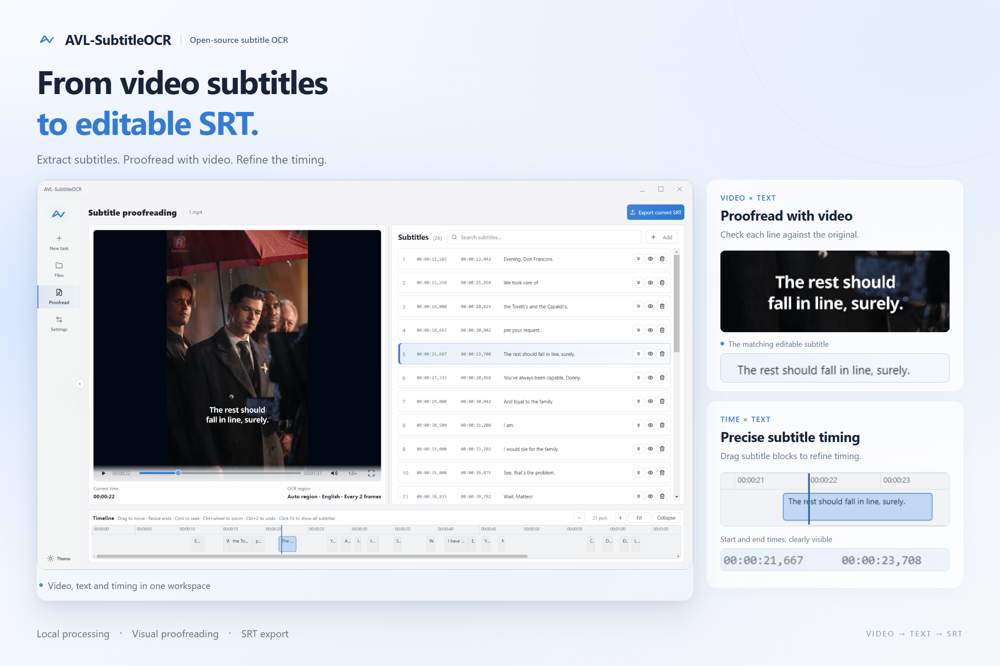
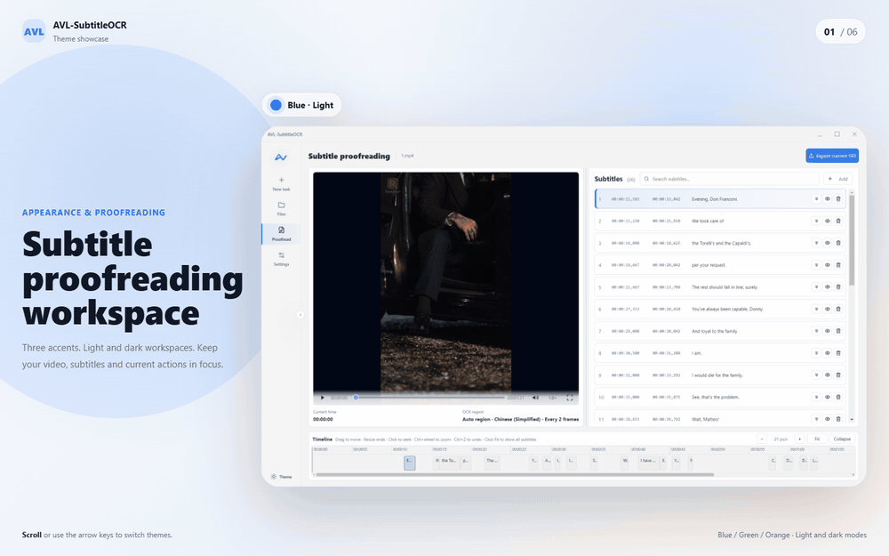

<p align="center">
  
</p>

<p align="center">
  <a href="README.md"></a>
  <a href="README.en.md"></a>
</p>

<p align="center">
  A local subtitle OCR tool for Windows: detect subtitles in video frames, proofread the results, and export <code>.srt</code> files.
</p>

<p align="center">
  <a href="https://github.com/allvoicelab/AVL-SubtitleOCR/releases"></a>
  <a href="LICENSE"></a>
  
  <a href="https://www.allvoicelab.cn/?utm_source=github&amp;utm_medium=readme&amp;utm_campaign=avl_subtitleocr&amp;utm_content=en"></a>
  <a href="https://www.allvoicelab.cn/contact?source=home_page_direct&amp;utm_source=github&amp;utm_medium=readme&amp;utm_campaign=avl_subtitleocr&amp;utm_content=en"></a>
  
</p>

We are the algorithm team at **AllVoiceLab (AVL)**, working on entertainment media processing, subtitle production, speech, and multimodal understanding. **AVL-SubtitleOCR** is our open-source tool for local subtitle recognition and proofreading. It includes a Windows desktop application and source code for the desktop interface, Python backend, and OCR pipeline.

[Download for Windows](https://github.com/allvoicelab/AVL-SubtitleOCR/releases) · [Run from source](#running-from-source) · [Build guide](BUILDING.en.md) · [User guide](docs/USER_GUIDE.en.md)

## Features

AVL-SubtitleOCR recognizes **subtitles burned into video frames**. It does not transcribe audio or extract subtitle tracks embedded in a video container.

- **Automatic subtitle detection:** Find subtitle regions, sample frames for OCR, and merge the results into a subtitle timeline.
- **Batch processing:** Queue multiple videos, track progress, stop or rerun tasks, and export an SRT file for each video.
- **Visual proofreading:** Compare the results with the video and edit subtitle text and timing before export.
- **Chinese and English interface:** Chinese by default. Choose a language in the startup introduction or **Settings → Interface language**. Changes apply immediately and are remembered across restarts.

Supports `mp4`, `mov`, `mkv`, `avi`, and `webm` videos, with 53 recognition-language options when creating a task (including aliases for French and German). Results are exported as standard `.srt` files. Recognition runs locally without uploading your videos.

You can also drop in a Windows shortcut (`.lnk`) that points to a video. The application follows the shortcut to read the original file.



## Recognition Quality

Across **80 Chinese and English video clips**, AVL-SubtitleOCR achieved the **lowest NED and SubER scores among the tools compared**. Compared with video-subtitle-extractor (VSE), **NED was approximately 5.5% lower and SubER was 32.1% lower**.

### Quality Comparison

In the table below, AVL-SubtitleOCR uses the default `ocr_interval=2` configuration (one sampled frame every 2 video frames).

| Tool | NED ↓ | SubER ↓ |
| --- | ---: | ---: |
| **AVL-SubtitleOCR (this project)** | **0.065037** | **5.2865** |
| video-subtitle-extractor | 0.0688 | 7.785 |
| RapidVideoOCR | 0.0840 | 12.022 |
| VidSubX | 0.1312 | 21.846 |
| VideOCR | 0.1336 | 14.038 |
| Video Subtitle OCR | 0.3318 | 26.420 |
| videocr-PappleOCR | 0.4855 | 59.553 |

**Lower is better for both metrics.** NED measures text differences from the reference subtitles; [SubER](https://github.com/apptek/SubER) evaluates subtitle text, segmentation, and timing together.

The test set contains **4 Chinese and 4 English series, with 10 clips per series**. Chinese clips cover landscape and portrait videos, animation, and live action; English clips cover landscape and portrait live action. The clips mainly come from short drama episodes lasting a few minutes.

### Subtitle Completeness

The comparison below shows subtitle regions from the same portrait English video at **0.0, 1.6, 5.2, and 8.7 seconds**, arranged in chronological order. The smaller text is burned into the original video; the larger text below it is the extracted output. **AVL-SubtitleOCR captures both the opening line, “And when she left,” and the final line, “you reminded me of Vera.” Both are missing from the VSE output.**


<details>
<summary>Chinese and English results and more comparison examples</summary>

The Chinese and English results below use `ocr_interval=1` (recognition on every frame), whereas the overall table above uses the default `ocr_interval=2`. Averaging these per-language results does not produce the overall table because the configurations differ. VSE uses a manually selected subtitle region.

| Language | Metric ↓ | AVL-SubtitleOCR | VSE | Relative reduction |
| --- | --- | ---: | ---: | ---: |
| Chinese | NED | **0.060861** | 0.066141 | 7.98% |
| Chinese | SubER | **3.3901** | 4.2842 | 20.87% |
| English | NED | **0.052590** | 0.071385 | 26.33% |
| English | SubER | **6.4761** | 11.2860 | 42.62% |

Chinese animation and bilingual subtitle outputs are shown side by side below.

<table>
  <tr>
    <th>Scene</th>
    <th>AVL-SubtitleOCR</th>
    <th>video-subtitle-extractor</th>
  </tr>
  <tr>
    <td>Chinese animation</td>
    <td></td>
    <td></td>
  </tr>
  <tr>
    <td>Chinese and English subtitles</td>
    <td></td>
    <td></td>
  </tr>
</table>

</details>

## Appearance and Experience

Recognize and proofread subtitles in one workspace, with light or dark themes and blue, green, or orange accents to suit your preferences.



## Download and Quick Start

Download `AVL-SubtitleOCR-Setup-<version>.exe` from [Releases](https://github.com/allvoicelab/AVL-SubtitleOCR/releases) and run the installer. Launch the app from the Start menu or desktop shortcut, and uninstall it through Windows Settings.

| Requirement | Details |
| --- | --- |
| Operating system | Windows 10 / 11, 64-bit |
| Additional setup | No manual installation of Python, CUDA, cuDNN, or an OCR environment is required |
| First launch | The current package is not code-signed. If SmartScreen appears, verify the download source before choosing “Run anyway” |

1. In **New Task**, drop in videos and choose the recognition language and output folder. Leave the folder empty to save SRT files beside the videos.
2. Start recognition with the default settings. Track the queue and progress in **Files**.
3. Open **Proofread** to compare the results with the video, edit text and timing, and export SRT. You can also export multiple results from the file list.

See the [User Guide](docs/USER_GUIDE.en.md) for illustrated instructions, expert settings, shortcuts, themes, and troubleshooting.

## Running from Source

The desktop application and release builds currently target **Windows 10/11 x64**. Other platforms have not been validated. Development requires **Python 3.12+, Node.js 18+ (with npm), and Git**. Installing dependencies for the first time requires internet access.

Run in Windows PowerShell:

```powershell
git clone https://github.com/allvoicelab/AVL-SubtitleOCR.git
cd AVL-SubtitleOCR
python -m venv .venv
.\.venv\Scripts\python.exe -m pip install -r requirements.txt
.\.venv\Scripts\python.exe -m pip install -e avl-open
$env:PYTHON = (Resolve-Path .\.venv\Scripts\python.exe).Path
cd frontend
npm.cmd install
npm.cmd start
```

In a fresh clone, Electron uses the Python interpreter specified above to start the local backend, so packaging an exe first is unnecessary. If `dist\SubtitleSidecar\SubtitleSidecar.exe` already exists, development mode prefers that build; rebuild the backend after changing its Python code.

Required ONNX models and character dictionaries are included in `avl-open/avl_open_ocr/model_files/`. See the [Build Guide](BUILDING.en.md) for full source setup, troubleshooting, backend rebuilds, and Setup / Portable packaging instructions.

## Project Structure and Technology

| Path | Responsibility |
| --- | --- |
| `frontend/` | Electron desktop interface, video preview, task management, and proofreading |
| `sidecar/` | Local Python backend for tasks, previews, and frontend communication |
| `app/` | OCR adapter and SRT formatting |
| `avl-open/` | OCR algorithms, ONNX models, and character dictionaries |
| `docs/` | User guides, screenshots, and comparison examples |

Pipeline: **Import video → Detect subtitle regions → Sample frames and recognize text → Merge subtitle timing → Proofread visually → Export SRT**.

Text detection uses a model from DamoDBNet, and text recognition uses models from [PaddleOCR](https://github.com/PaddlePaddle/PaddleOCR). The models are converted to ONNX and run locally with [ONNX Runtime](https://github.com/microsoft/onnxruntime). The AVL team implements subtitle-region scanning, video task management, timeline processing, and the proofreading interface around these models. See [Third-Party Notices (Chinese)](THIRD_PARTY_NOTICES.md) for component and model sources.

## Processing and Data

Video reading, OCR, and SRT export all run on your computer. The open-source version does not require an internet connection for recognition by default. For `mkv` / `avi` and other videos that cannot play directly, the application creates a temporary local MP4 cache by remuxing or transcoding, depending on the codecs. Transcoding may take longer.

Choose **Auto**, **CPU only**, or **Prefer GPU** for inference. GPU acceleration uses DirectML and can be tried with NVIDIA, AMD, and Intel integrated GPUs; the application falls back to CPU when unavailable. Processing time depends on video length, subtitle density, frame sampling interval, CPU cores, and device performance.

Logs are saved to `%APPDATA%\avl-subtitle-ocr\logs\`. Logs, screenshots, and file paths may contain video names or user directories. Remove personal or sensitive details before sharing an issue.

## Feedback and Support

Start with [User Guide — Troubleshooting and further reading](docs/USER_GUIDE.en.md#troubleshooting-and-further-reading). For source setup or packaging issues, see the [Build Guide](BUILDING.en.md).

If the issue persists, report it through [GitHub Issues](https://github.com/allvoicelab/AVL-SubtitleOCR/issues). Include the version, installation method (package / source), Windows version, recognition language, expert settings, reproduction steps, and relevant logs. Remove sensitive details from logs and screenshots before sharing.

## Contributing

You can help improve the project through [GitHub Issues](https://github.com/allvoicelab/AVL-SubtitleOCR/issues):

- **Bug reports:** Include reproduction steps, expected and actual behavior, and relevant logs with sensitive details removed. Search existing issues before opening a new one.
- **Recognition samples and evaluation:** Share short video clips or screenshots you have permission to make public, along with reference subtitles and recognition results. Include the language, application version, and settings to help us evaluate different scenarios.
- **Documentation and translation:** Point out errors in the user guide, suggest clearer instructions, or provide translations and revised text.
- **Feature requests:** Describe your workflow, the problem you are trying to solve, and the improvement you would like to see.

The repository currently does not accept external code pull requests. Please use issues for discussion and submissions. Share only content you have the right to distribute, and state the source and permissions for third-party materials. Unless explicitly agreed otherwise, documentation or code contributions intended for inclusion in the project are submitted under Apache-2.0.

## About AVL and Business Inquiries

For larger-scale subtitle recognition, entertainment media structuring, content moderation, search, translation, localization, or private enterprise deployments, visit the [AllVoiceLab website](https://www.allvoicelab.cn/?utm_source=github&utm_medium=readme&utm_campaign=avl_subtitleocr&utm_content=en) or contact us through [Business Inquiries](https://www.allvoicelab.cn/contact?source=home_page_direct&utm_source=github&utm_medium=readme&utm_campaign=avl_subtitleocr&utm_content=en) to learn about our paid products and services. This open-source tool serves lightweight local workflows; our commercial products address higher throughput, stronger quality control, and more complete production workflows.

## Contributors

<p>
  <a href="https://github.com/tang576225574"></a>
  <a href="https://github.com/Sam1mxs"></a>
  <a href="https://github.com/SamanthaMengjunyu"></a>
  <a href="https://github.com/hyzhan"></a>
  <a href="https://github.com/kkpretend"></a>
  <a href="https://github.com/rukaicai"></a>
</p>

## License

AVL-SubtitleOCR's original code and documentation are released under the [Apache License 2.0](LICENSE).

Third-party components, model weights, character dictionaries, and icons retain their original copyrights and are subject to their respective licenses. See [Third-Party Notices (Chinese)](THIRD_PARTY_NOTICES.md) for the projects and license references.

Copyright 2026 AllVoiceLab and contributors.

## Acknowledgements

We thank the following open-source projects and their contributors:

- [PaddleOCR](https://github.com/PaddlePaddle/PaddleOCR) provides recognition models and character dictionaries, forming an important foundation for this project's OCR capabilities.
- [DamoDBNet](https://modelscope.cn/models/iic/cv_resnet18_ocr-detection-db-line-level_damo) provides detection models
- [ONNX Runtime](https://github.com/microsoft/onnxruntime) provides local model inference.
- [Electron](https://github.com/electron/electron) provides the desktop application runtime.
- [OpenCV](https://github.com/opencv/opencv), [PyAV](https://github.com/PyAV-Org/PyAV), and [FFmpeg](https://ffmpeg.org/) provide image processing, video reading, and preview capabilities.
- [NumPy](https://numpy.org/), [Pillow](https://python-pillow.github.io/), [PyClipper](https://github.com/fonttools/pyclipper), [Shapely](https://github.com/shapely/shapely) / [GEOS](https://libgeos.org/), and [Lucide](https://lucide.dev/) provide numerical computing, image decoding and encoding, geometry operations, and interface icons.

## Citation

If you use this tool in research or evaluation, please consider mentioning AVL-SubtitleOCR and citing the upstream models and work you use. See [PaddleOCR's official citation guidance](https://github.com/PaddlePaddle/PaddleOCR#-citation) for papers and BibTeX entries.
