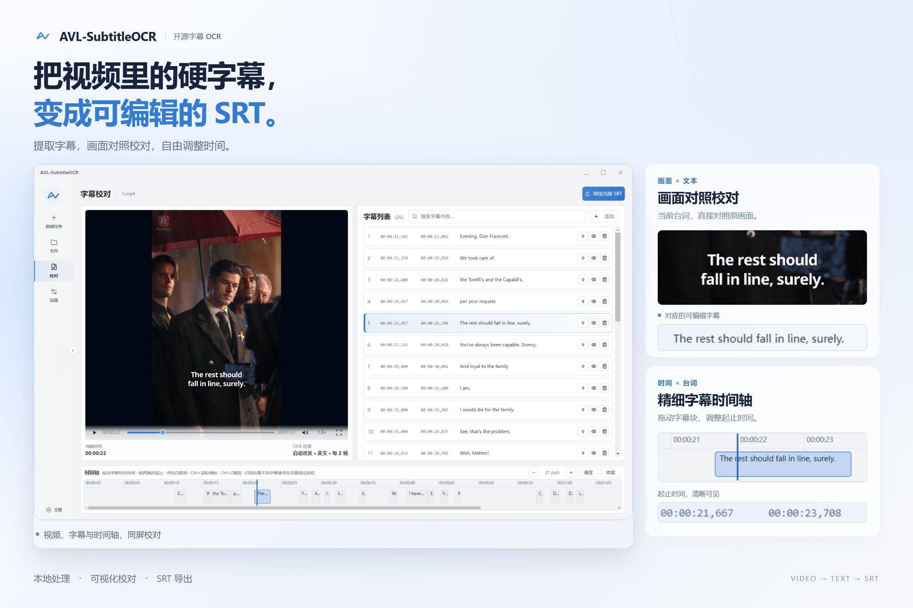
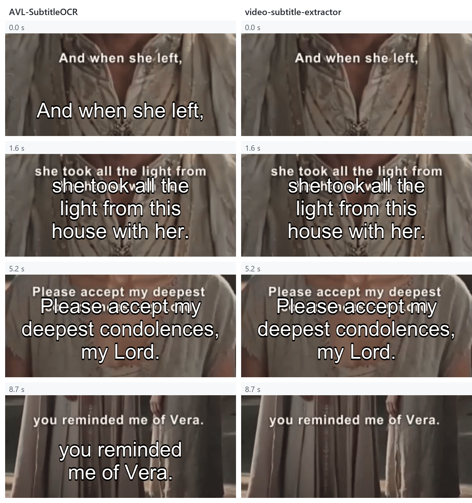
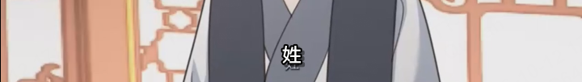
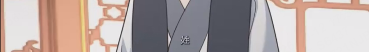
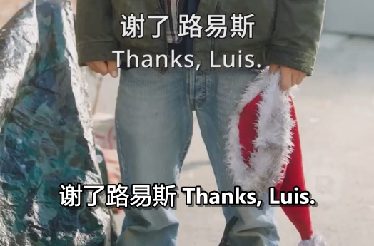
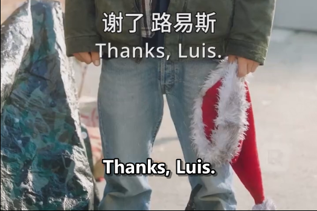
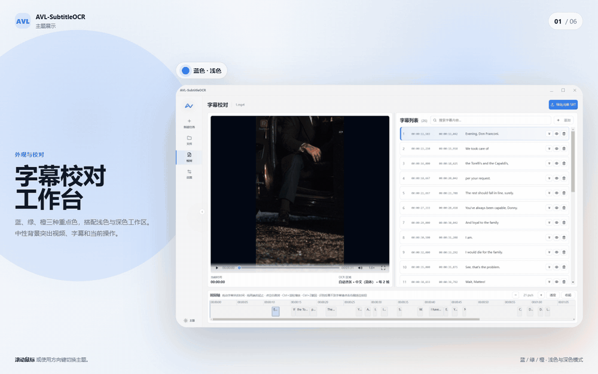

<p align="center">
  
</p>

<p align="center">
  <a href="README.md"></a>
  <a href="README.en.md"></a>
</p>

<p align="center">
  Windows 本地硬字幕 OCR 工具：自动检测视频画面字幕，校对并导出为 <code>.srt</code>。
</p>

<p align="center">
  <a href="https://github.com/allvoicelab/AVL-SubtitleOCR/releases"></a>
  <a href="LICENSE"></a>
  
  <a href="https://www.allvoicelab.cn/?utm_source=github&amp;utm_medium=readme&amp;utm_campaign=avl_subtitleocr&amp;utm_content=zh-CN"></a>
  <a href="https://www.allvoicelab.cn/contact?source=home_page_direct&amp;utm_source=github&amp;utm_medium=readme&amp;utm_campaign=avl_subtitleocr&amp;utm_content=zh-CN"></a>
  
</p>

我们是 **趣丸千音（AllVoiceLab，简称 AVL）算法团队**，专注泛娱乐内容处理、字幕生产、语音与多模态理解。**AVL-SubtitleOCR** 是我们开源的本地硬字幕识别与校对工具，提供 Windows 桌面应用，以及桌面界面、Python 后端和 OCR 处理流程的源码。

[下载 Windows 应用](https://github.com/allvoicelab/AVL-SubtitleOCR/releases) · [从源码运行](#从源码运行) · [构建指南](BUILDING.md) · [使用指南](docs/USER_GUIDE.md)

## 功能概览

AVL-SubtitleOCR 面向的是 **已经压制在视频画面里的硬字幕**，而不是音频转写，也不是抽取视频容器里的内挂字幕轨。

- **自动检测字幕**：定位字幕区域，抽帧识别文字，再将结果合并为字幕时间轴。
- **批量处理视频**：多个视频一起加入队列，查看进度、停止或重跑任务，并分别导出 SRT。
- **对照画面校对**：在视频预览中检查识别结果，修改字幕文本和时间，再导出文件。
- **中英文界面**：默认中文，可在启动介绍弹窗或“设置 → 界面语言”选择 English，选择立即生效并自动保存，下次启动沿用。

支持 `mp4`、`mov`、`mkv`、`avi`、`webm` 视频，新建任务时提供 53 个识别语言选项（含法语、德语的别名），结果导出为标准 `.srt` 文件。识别在本机完成，无需上传视频。

也可以拖入指向视频的 Windows 快捷方式（`.lnk`），软件会沿着快捷方式读取原始视频文件。



## 效果对比

在 **80 个中英文视频片段**的测试中，AVL-SubtitleOCR 的 **NED 和 SubER 均为参与对比工具中的最低值**。相较 video-subtitle-extractor（VSE），**NED 降低约 5.5%，SubER 降低约 32.1%**。

### 识别质量

下表中，本项目使用默认配置 `ocr_interval=2`（每 2 帧采样一帧进行识别）。

| 工具 | NED ↓ | SubER ↓ |
| --- | ---: | ---: |
| **AVL-SubtitleOCR（本项目）** | **0.065037** | **5.2865** |
| video-subtitle-extractor | 0.0688 | 7.785 |
| RapidVideoOCR | 0.0840 | 12.022 |
| VidSubX | 0.1312 | 21.846 |
| VideOCR | 0.1336 | 14.038 |
| Video Subtitle OCR | 0.3318 | 26.420 |
| videocr-PappleOCR | 0.4855 | 59.553 |

**两项指标均越低越好。** NED 衡量识别文本与参考字幕的差异；[SubER](https://github.com/apptek/SubER) 综合衡量字幕文字、分段和时间轴质量。

测试集包含中文、英文各 **4 部剧集、每部 10 个片段**：中文覆盖横屏、竖屏、动画和真人剧，英文覆盖横屏、竖屏真人剧，片段主要来自数分钟的短剧。

### 字幕完整性

下面截取同一段英文竖屏视频在 **0.0、1.6、5.2、8.7 秒**的字幕区域，按时间顺序并排展示。画面中原有的小字是硬字幕，下方的大字是工具提取结果：**本项目保留了首句 “And when she left,” 和末句 “you reminded me of Vera.”，VSE 输出中缺少这两句字幕。**




<details>
<summary>查看中英文详细结果与更多对比样例</summary>

以下中英文分项结果使用 `ocr_interval=1`（每帧识别），与上方总表的默认 `ocr_interval=2` 配置不同，不应将分项结果直接平均后与总表比较。VSE 使用手动框选字幕区域。

| 语言 | 指标 ↓ | AVL-SubtitleOCR | VSE | 相对降低 |
| --- | --- | ---: | ---: | ---: |
| 中文 | NED | **0.060861** | 0.066141 | 7.98% |
| 中文 | SubER | **3.3901** | 4.2842 | 20.87% |
| 英文 | NED | **0.052590** | 0.071385 | 26.33% |
| 英文 | SubER | **6.4761** | 11.2860 | 42.62% |

下面将中文动画和中英双语字幕的输出成对展示，便于直接对照。

<table>
  <tr>
    <th>场景</th>
    <th>AVL-SubtitleOCR</th>
    <th>video-subtitle-extractor</th>
  </tr>
  <tr>
    <td>中文动画字幕</td>
    <td></td>
    <td></td>
  </tr>
  <tr>
    <td>中英双语字幕</td>
    <td></td>
    <td></td>
  </tr>
</table>

</details>

## 外观与使用体验

在同一个工作台中完成识别与校对，也可以按自己的习惯选择浅色或深色主题，以及蓝色、绿色或橙色重点色。



## 下载与快速使用

从 [Releases](https://github.com/allvoicelab/AVL-SubtitleOCR/releases) 下载 `AVL-SubtitleOCR-Setup-<version>.exe`，双击安装。安装后可从开始菜单或桌面快捷方式启动，也可以从系统设置里卸载。

| 环境 | 要求 |
| --- | --- |
| 系统 | Windows 10 / 11，64 位 |
| 额外依赖 | 无需手动安装 Python、CUDA、cuDNN 或 OCR 环境 |
| 首次启动 | 当前安装包尚未做代码签名。若出现 SmartScreen 提示，请确认下载来源后选择“仍要运行” |

1. 在“新建任务”中拖入视频，选择识别语言和输出目录；目录留空时，SRT 保存到视频旁边。
2. 使用默认参数开始识别，在“文件”页查看队列和进度。
3. 完成后进入“校对”页，对照视频修改字幕文字和时间轴，再导出 SRT；也可在文件列表中批量导出。

图解步骤、专家参数、快捷键、主题设置和故障排查见 [使用指南](docs/USER_GUIDE.md)。

## 从源码运行

当前桌面应用与发布构建面向 **Windows 10/11 x64**；其他平台尚未验证。开发环境需要 **Python 3.12+、Node.js 18+（含 npm）和 Git**，首次安装依赖需要联网。

在 Windows PowerShell 中执行：

```powershell
git clone https://github.com/allvoicelab/AVL-SubtitleOCR.git
cd AVL-SubtitleOCR
python -m venv .venv
.\.venv\Scripts\python.exe -m pip install -r requirements.txt
.\.venv\Scripts\python.exe -m pip install -e avl-open
$env:PYTHON = (Resolve-Path .\.venv\Scripts\python.exe).Path
cd frontend
npm.cmd install
npm.cmd start
```

全新克隆时，Electron 会通过上面指定的 Python 启动本地后端，无需先打包 exe。如果已有 `dist\SubtitleSidecar\SubtitleSidecar.exe`，开发模式会优先使用该产物；修改 Python 代码后需注意重建后端。

运行所需的 ONNX 模型与字符表已包含在 `avl-open/avl_open_ocr/model_files/`。源码运行、环境排查、后端重建及 Setup / Portable 打包的完整步骤见 [构建指南](BUILDING.md)。

## 项目结构与技术组成

| 路径 | 职责 |
| --- | --- |
| `frontend/` | Electron 桌面界面、视频预览、任务管理与字幕校对 |
| `sidecar/` | 本地 Python 后端，处理任务、预览及前后端通信 |
| `app/` | OCR 适配层与 SRT 格式化 |
| `avl-open/` | OCR 算法、ONNX 模型与字符表 |
| `docs/` | 使用指南、界面截图与对比样例 |

处理流程：**导入视频 → 自动检测字幕区域 → 抽帧与文字识别 → 合并字幕时间轴 → 可视化校对 → 导出 SRT**。

文字检测使用 DamoDBNet 来源的模型，文字识别使用 [PaddleOCR](https://github.com/PaddlePaddle/PaddleOCR) 来源的模型；模型转换为 ONNX 后，由 [ONNX Runtime](https://github.com/microsoft/onnxruntime) 在本机推理。AVL 团队在此基础上实现字幕区域扫描、视频任务管理、时间轴处理与校对界面。第三方组件与模型来源见 [第三方组件说明](THIRD_PARTY_NOTICES.md)。

## 运行与数据

视频读取、OCR 识别和 SRT 导出都在你的电脑上完成，开源版本默认无需联网识别。预览 `mkv` / `avi` 等无法直接播放的视频时，软件会根据编码情况，在本机重封装或转码为临时 MP4 缓存；转码可能需要更长时间。

推理设备可选“自动”“CPU”或“优先 GPU”。GPU 加速通过 DirectML 实现，NVIDIA、AMD 和 Intel 核显均可尝试，不可用时会回落到 CPU。处理耗时取决于视频长度、字幕密度、帧采样间隔、CPU 核数和设备性能。

日志保存在 `%APPDATA%\avl-subtitle-ocr\logs\`。日志、截图和文件路径中可能包含视频名或用户目录，提交 issue 前请先去除个人或敏感信息。

## 反馈与支持

遇到问题时，请先查看 [使用指南 · 问题处理与进一步了解](docs/USER_GUIDE.md#问题处理与进一步了解)；源码运行或打包问题请查看 [构建指南](BUILDING.md)。

仍无法解决时，通过 [GitHub Issues](https://github.com/allvoicelab/AVL-SubtitleOCR/issues) 提交版本号、安装方式（安装包 / 源码）、Windows 版本、识别语言、专家参数、复现步骤及相关日志。提交日志和截图前请先脱敏。

## 参与贡献

欢迎通过 [GitHub Issues](https://github.com/allvoicelab/AVL-SubtitleOCR/issues) 参与改进：

- **问题反馈**：提供复现步骤、预期结果、实际结果和必要的脱敏日志；提交前请先搜索已有 issue。
- **识别样例与评测**：分享有权公开的短视频片段或截图、对应字幕和识别结果，注明语言、软件版本与参数，帮助我们验证不同场景的效果。
- **文档与翻译**：指出使用指南中的错误、补充操作说明，或提交翻译建议与修订文本。
- **功能建议**：说明使用场景、遇到的问题及期望的改进，方便我们评估优先级。

当前仓库暂不接受外部代码 Pull Request，以上贡献以 issue 讨论和材料提交为主。请仅提交你有权分享的内容，并说明第三方材料的来源与授权范围；对拟纳入项目的文档或代码贡献，除另有明确约定外，按本项目的 Apache-2.0 许可提交。

## 关于 AVL 与商务合作

如果你在做更大规模的字幕识别、泛娱乐资产结构化、内容审核、检索、翻译、本地化或企业私有化流程，欢迎访问 [AVL 官网](https://www.allvoicelab.cn/?utm_source=github&utm_medium=readme&utm_campaign=avl_subtitleocr&utm_content=zh-CN)，或通过 [商务合作](https://www.allvoicelab.cn/contact?source=home_page_direct&utm_source=github&utm_medium=readme&utm_campaign=avl_subtitleocr&utm_content=zh-CN) 联系 AVL 团队了解我们的付费产品和服务。开源工具解决的是轻量、可本地运行的基础需求；商业版本会覆盖更高吞吐、更强质量控制和更完整的生产链路。

## Contributors / 项目贡献者

<p>
  <a href="https://github.com/tang576225574"></a>
  <a href="https://github.com/Sam1mxs"></a>
  <a href="https://github.com/SamanthaMengjunyu"></a>
  <a href="https://github.com/hyzhan"></a>
  <a href="https://github.com/kkpretend"></a>
  <a href="https://github.com/rukaicai"></a>
</p>

## 许可证

AVL-SubtitleOCR 的自有代码与文档采用 [Apache License 2.0](LICENSE) 发布。

本项目使用的第三方组件、模型权重、字符表及图标保留其原有版权，并适用各自的许可证。相关项目及许可索引见 [第三方组件说明](THIRD_PARTY_NOTICES.md)。

Copyright 2026 AllVoiceLab and contributors.

## 致谢

感谢以下开源项目及其贡献者：

- [PaddleOCR](https://github.com/PaddlePaddle/PaddleOCR)：提供文字识别模型与字符表，是本项目 OCR 识别能力的重要基础。
- [DamoDBNet](https://modelscope.cn/models/iic/cv_resnet18_ocr-detection-db-line-level_damo)：提供文字检测模型
- [ONNX Runtime](https://github.com/microsoft/onnxruntime)：提供本地模型推理能力。
- [Electron](https://github.com/electron/electron)：提供桌面应用运行时。
- [OpenCV](https://github.com/opencv/opencv)、[PyAV](https://github.com/PyAV-Org/PyAV) 与 [FFmpeg](https://ffmpeg.org/)：提供图像处理、视频读取与预览能力。
- [NumPy](https://numpy.org/)、[Pillow](https://python-pillow.github.io/)、[PyClipper](https://github.com/fonttools/pyclipper)、[Shapely](https://github.com/shapely/shapely) / [GEOS](https://libgeos.org/) 及 [Lucide](https://lucide.dev/)：提供数值计算、图像编解码、几何运算与界面图标。

## 引用

如在研究或评测中使用本工具，欢迎注明 AVL-SubtitleOCR，并引用实际使用的上游模型与相关工作。PaddleOCR 的论文与 BibTeX 请参阅其 [官方引用说明](https://github.com/PaddlePaddle/PaddleOCR#-citation)。
