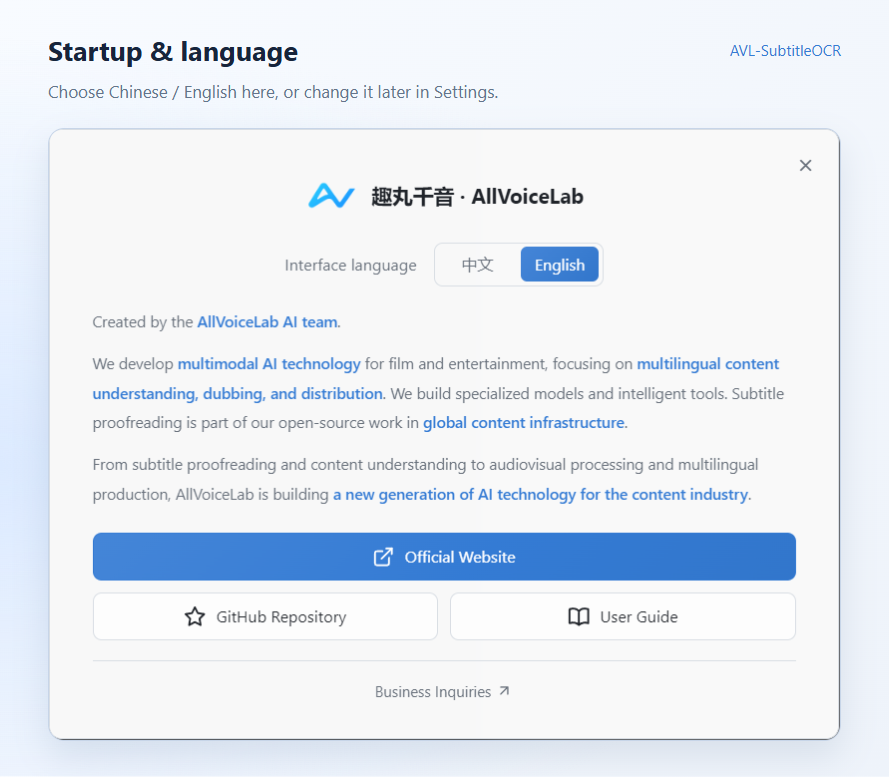
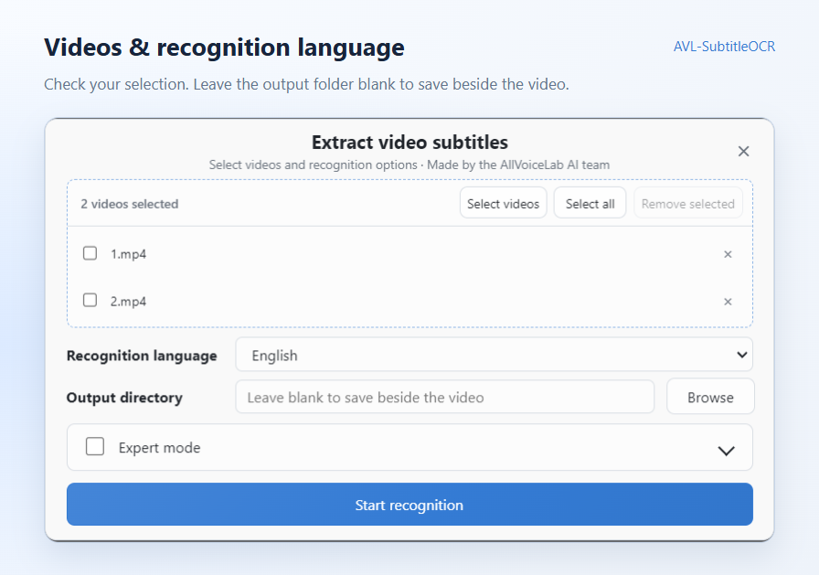
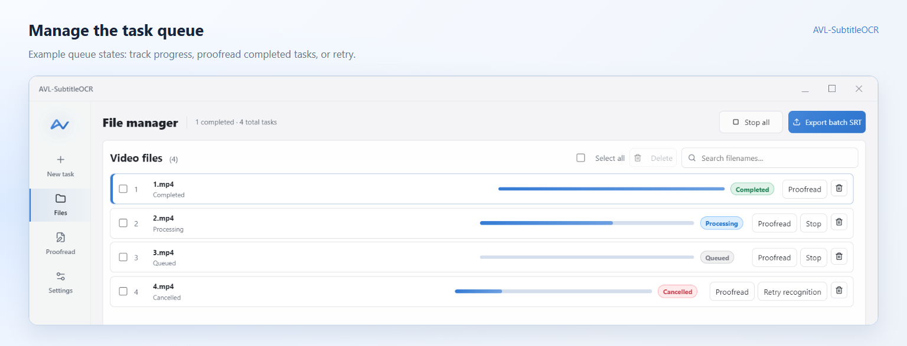
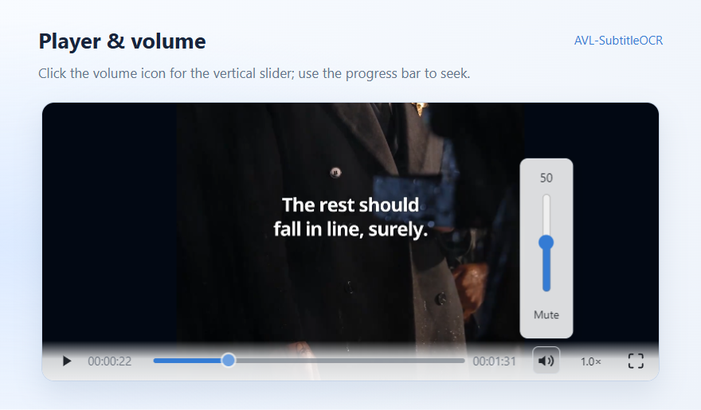
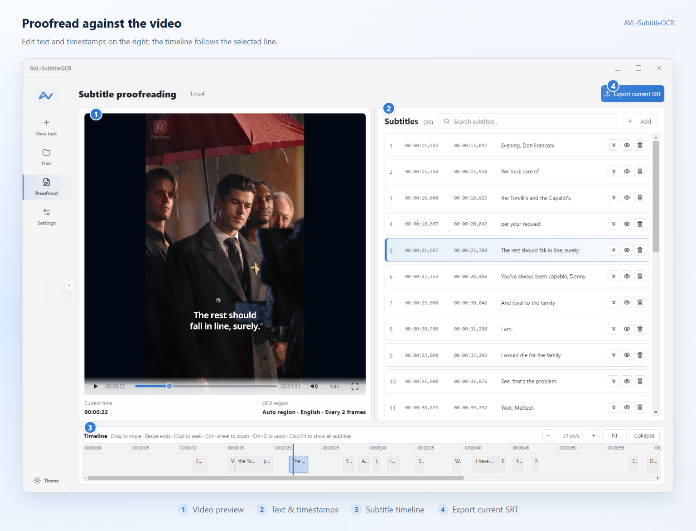
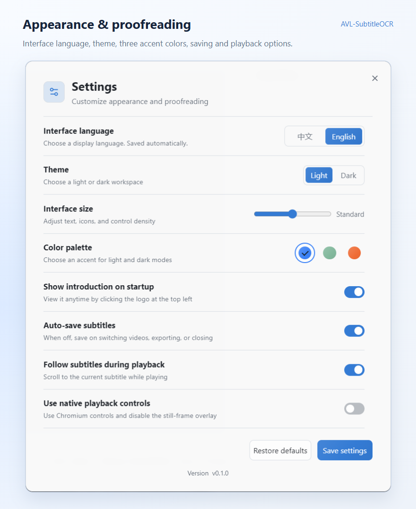
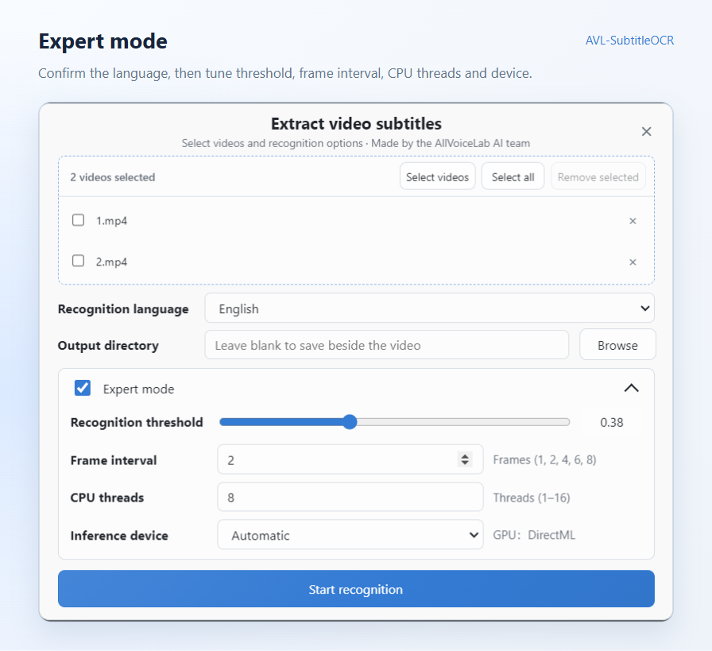

  

<h1 align="center">AVL-SubtitleOCR User Guide</h1>

  
  

From your first video to a proofread SRT.

  <a href="#everyday-use">Everyday use</a> · <a href="#expert-mode">Expert mode</a> · <a href="#frequently-asked-questions">FAQ</a> · <a href="../README.en.md">Project overview</a>

**Add videos → Choose a language → Start recognition → Proofread → Export SRT**

Recognition runs locally, without uploading videos or requiring an internet connection. The tool reads **hard subtitles burned into the video image**. It does not transcribe speech or extract embedded subtitle tracks.

| What you want to do | Start here |
| --- | --- |
| Recognize, proofread and export your first video | [Everyday use](#everyday-use) |
| Reduce missing text or errors, or adjust speed and CPU use | [Expert mode](#expert-mode) |
| Troubleshoot a problem, find logs or report an issue | [Troubleshooting and further reading](#troubleshooting-and-further-reading) |

Screenshots show the English interface of the current Windows EXE. The [Chinese guide](USER_GUIDE.md) includes matching Chinese screenshots.

## Everyday use

Start with the defaults. Complete one recognition run and check its results before changing parameters.

### 1. Install and launch

- **Requirements**: Windows 10 / 11, 64-bit. No separate Python, CUDA or OCR environment is required.
- **Installer (Setup)**: run the installer, then launch from the desktop or Start menu shortcut.
- **Portable build**: launch it directly. It extracts files on each launch, so startup is usually slower than the installed build.

The current build is unsigned. If Windows displays a SmartScreen prompt, verify the download source before selecting **More info → Run anyway**.

The product introduction appears on first launch. Close it to start working. To stop showing it on launch, turn off **Settings → Show introduction on startup**.

The interface starts in Chinese. Choose **English** in the introduction to switch immediately; the app remembers your choice. You can also change **Settings → Interface language**, even when the introduction is disabled. Interface language and recognition language are saved separately: changing the interface does not change the video language or subtitle text. **Restore defaults** returns the interface to Chinese.

View startup and interface language selection

### 2. Start recognition

#### Add videos

Open **New task** and drag videos into the selection area, or click the area to select them. After making a selection, use **Select videos** to add more. You can select multiple files at once and add them in several batches without replacing the current selection.

Supported formats: `mp4`, `mov`, `mkv`, `avi`, `webm`.

To remove an unwanted file, click its `×`, or select it and click **Remove selected**. This removes it from the selection; it does not delete the original video.

#### Choose a language and output folder

- **Recognition language**: select the language of the subtitles in your video. The default is **Chinese (Simplified)**. The interface offers 53 language options (including aliases for French and German); Chinese and English have been tested with samples. Try a small sample first for other languages.
- **Output directory**: leave it blank to save the SRT beside its video, or choose **Browse** to select a folder.
- **Expert mode**: keep the defaults for your first run. See [Expert mode](#expert-mode) when you need to adjust quality or speed.

#### Run recognition

Click **Start recognition**. The app opens **Files** and processes the queue. Each row shows its status, progress and current stage.

| Status | Meaning |
| --- | --- |
| Pending / Queued | Not started, or waiting for its turn |
| Processing | Recognizing subtitles |
| Completed | Recognition finished; check the output notice to confirm that the SRT was written |
| Modified | Subtitles were edited; check for unsaved-change or write-failure notices |
| Cancelled / Failed | Stopped or encountered an error; use **Retry recognition** |

The first recognition run loads the models and may take several seconds to tens of seconds before processing begins.

**Recognition saves detected subtitles to `video-name.srt`, overwriting an existing SRT with the same name.** A first run with no subtitles does not create an empty SRT. An empty result on a rerun may clear the previous SRT recorded for that task. Back up existing results before rerunning.

### 3. Proofread subtitles

In **Files**, click **Proofread** beside a completed video. The workspace has video on the left, subtitle text on the right and a timeline below.

#### Edit text and timing

- Click a subtitle row to seek to its position and pause for comparison. The eye icon also locates that subtitle.
- Edit the recognition result directly in its text field.
- Edit start or end timestamps using `hours:minutes:seconds,milliseconds`, such as `00:01:23,500`. The app constrains invalid timing and overlap with neighboring subtitles.
- Drag a timeline block to move a subtitle. Drag its edges to change its start or end.
- Use **Add** to insert an empty subtitle. Delete a row with its trash icon; use **Undo** in the notification to restore an accidental deletion.
- **Merge with next subtitle** extends the current subtitle to the next subtitle's end, but **keeps only the current row's text**. Copy any text you want to keep from the next row first.
- Press `Ctrl+Z` to undo proofreading changes. Each video keeps the latest 20 undo steps; closing the app or rerunning recognition clears that history.

**Wait until recognition finishes before proofreading.** Changes cannot be saved during recognition, and new recognition results replace the existing subtitles.

#### Preview the video

Try playing `mp4`, `mov` and `webm` directly. For `mkv`, `avi`, or other videos marked as requiring preparation, click **Prepare preview** first. The app remuxes or transcodes to a local MP4 cache depending on the codecs; transcoding may take longer. If playback is unavailable, use **Open in system player**.

Click the volume icon to open its vertical slider. Use the progress bar to seek. Drag the divider between the video and subtitle list to adjust their widths.

The timeline's `−` / `+` controls change zoom. **Fit** brings the subtitle time range into view; **Collapse** temporarily hides the timeline. If subtitle blocks are out of view after recognition, click **Fit**.

View player and volume controls

### 4. Save and export

**Auto-save subtitles** is on by default. Changes are written to the SRT after about 0.5 seconds. With auto-save off, edits stay in memory until you switch videos, export or close the window.

- **One video**: click **Export current SRT** in the proofreading workspace.
- **Multiple videos**: click **Export batch SRT** in **Files**. Each video produces a separate SRT.

Export uses your latest proofreading changes. **An existing file with the same name is overwritten.**

If the app reports unsaved changes or a write failure, confirm that saving succeeds before exiting. Close any player or editor using the SRT, check folder permissions and free disk space, then export again.

### 5. Batch tasks and continuing later

- Videos added during a run go to the end of the queue and use that run's recognition parameters.
- **Stop** cancels one task and continues with the next. **Stop all** clears the queue.
- Use **Retry recognition** for cancelled or failed tasks.
- With the same parameters, batch processing skips completed and modified tasks. Changing recognition parameters or explicitly rerunning recognition may replace existing proofreading results.
- Deleting a task removes its list entry, not the video or saved SRT.

On reopening, the app restores the task list and your last proofreading position. It does not start recognition automatically. You can continue editing saved subtitles; if the SRT was deleted or cannot be read, run recognition again.

If a video is marked as missing, use **Locate file** on its row to locate the moved or renamed file.

### 6. Settings and shortcuts

**Settings** controls interface language, light/dark mode, three blue/green/orange accent swatches, interface size, auto-save and subtitle tracking during playback. Language selection is saved immediately. After adjusting other options, use **Save settings** to close the panel.

The current app version appears at the bottom of Settings. Include it when reporting a problem.

| Shortcut | Action |
| --- | --- |
| `Space` | Play / pause |
| `←` / `→` | Step backward / forward by 1 frame |
| `Shift+←` / `Shift+→` | Step backward / forward by 10 frames |
| `Home` / `End` | Seek to the beginning / end |
| `[` / `]` | Set the active subtitle's start / end to the playhead |
| `Ctrl+Z` | Undo the last proofreading change |
| `Ctrl` + mouse wheel | Zoom the timeline |
| `Esc` | Cancel a timeline drag or close a dialog |

Playback shortcuts do not interrupt a text field, dropdown or dialog. `Ctrl+Z` still undoes proofreading changes when editing a subtitle row; in other text fields it keeps the field's usual undo behavior. `Esc` cancels a drag or closes a dialog. With the video/text divider focused, arrow keys adjust column widths instead of stepping the video.

## Expert mode

Expand **Expert mode** in **New task** when you need to reduce missing text or recognition errors, speed up a batch or control resource use. Identify the problem before adjusting a parameter.

### Parameter reference

| Parameter | Range | Default | Main effect |
| --- | --- | --- | --- |
| Recognition threshold | 0.05–0.95 | 0.38 | Balance missing text against false recognition |
| Frame interval | 1, 2, 4, 6, 8 frames | 2 frames | Sampling density, short subtitles and speed |
| CPU threads | 1–available CPU thread count | Half the available count | CPU use and processing speed |
| Inference device | Automatic / CPU / Prefer GPU | Automatic | CPU or GPU inference |

#### Recognition threshold: missing text and false recognition

A lower threshold accepts more results and may reduce missing text, but can introduce errors. A higher threshold is more selective and may reduce errors, but can miss subtitles. This value is not an accuracy score.

Make small changes from the default. For missing text, try `0.38 → 0.33`; for frequent false recognition, try `0.38 → 0.43`. Compare the output before adjusting further. These are starting points for testing, not ideal values for every video.

**Thresholds are remembered per language.** Changing the recognition language loads its saved threshold; check it before starting.

#### Frame interval: speed and short subtitles

An interval of 2 means sampling one frame every 2 frames. Smaller intervals sample more densely. Larger intervals usually run faster, but can miss subtitles that appear briefly.

At 30 fps, a 2-frame interval is about 67 milliseconds; an 8-frame interval is about 267 milliseconds. The same frame interval represents a different time spacing at a different frame rate.

- For brief subtitles or rapid changes, try 1–2 frames first.
- For longer-lasting subtitles, try 4 frames to reduce processing time, then check for missed short lines before trying 6 or 8.

#### CPU threads: leave room for other work

The default uses about half the available CPU thread count. For example, a device with 16 available threads defaults to 8. The default follows the device until you set a manual value; after that, your chosen value is retained.

Reduce the count if you need to use other apps during recognition. To improve speed, increase it gradually while watching runtime and responsiveness. More threads do not guarantee a proportional speedup.

#### Inference device: compare CPU and GPU performance

- **Automatic** prefers an available GPU execution provider and otherwise uses CPU. It currently uses the same selection policy as **Prefer GPU**.
- **CPU** fixes inference to the CPU, useful for comparing runtime or troubleshooting GPU issues.
- **Prefer GPU** attempts DirectML inference on NVIDIA, AMD or Intel graphics. If unavailable, it falls back to CPU.

Choosing **Prefer GPU** does not guarantee that the run used a GPU. Check the device information in task progress or in `sidecar.log`. Compare actual runtime on the same video.

### Adjust for your situation

| Situation | First adjustment to try | Check afterward |
| --- | --- | --- |
| Brief subtitles are missing | Reduce frame interval from 2 to 1 | Whether lines return and how much runtime increases |
| Recognized lines still have missing characters | Confirm the language, then lower the threshold slightly | Missing text versus new recognition errors |
| Too many false results | Raise the threshold slightly | Whether errors fall without losing real subtitles |
| Results are acceptable but processing takes too long | Increase frame interval from 2 to 4 | Short lines and rapid subtitle changes |
| The computer becomes sluggish | Reduce CPU threads | Responsiveness and acceptable runtime |
| You want to evaluate GPU acceleration | Compare **CPU** and **Prefer GPU** | The device actually used and runtime on the same video |

### Compare before running a batch

1. Choose a representative video containing clear subtitles, brief lines and difficult frames. Run the defaults, keep the SRT and record the runtime.
2. Change one parameter at a time and rerun the same video. Compare text, missing lines, timing and runtime.
3. Once satisfied, record language, threshold, frame interval, CPU threads and the device actually used. Apply the configuration to videos with similar subtitle styles.
4. After changing language, subtitle style or frame rate, test a small sample before processing a batch.

**Rerunning recognition replaces existing subtitles and overwrites an SRT with the same name.** Copy existing results to another folder before comparing, especially manually proofread versions. Videos added during a run use that run's parameters; test new parameters in a separate run.

Understand the pipeline: region scanning and recognition sampling

The app detects subtitle regions automatically, without manual selection. The initial region scan and the expert-mode frame interval are separate stages. The scan interval follows video frame rate: 2 frames below 60 fps, 4 frames from 60 to below 120 fps, and 8 frames at 120 fps or above.

The interface exposes the four parameters above. Subtitle regions, scan spacing, detection concurrency and the maximum merge gap are handled automatically or use internal defaults.

If adjustments do not resolve a problem, record the video's characteristics, settings, actual device and before/after output. This helps distinguish detection, text recognition and timing issues.

## Troubleshooting and further reading

### Frequently asked questions

**No subtitles were recognized, or too much text is missing?**  
Confirm that subtitles are visible in the video image and the recognition language is correct. Then use [Adjust for your situation](#adjust-for-your-situation) to test the threshold or frame interval one at a time.

**Recognition is slow, or the computer becomes sluggish?**  
For shorter runtime, try a larger frame interval or **Prefer GPU**. For better responsiveness, reduce CPU threads. See [Expert mode](#expert-mode). Video length, subtitle density and hardware also affect runtime.

**Clicking a subtitle does not show the matching frame?**  
For `mkv` and `avi`, click **Prepare preview** first. If **Use native playback controls** is on, turn it off to restore still-frame previews when selecting a subtitle.

**Where is the SRT saved?**  
With a blank output directory, it is saved beside the video; otherwise, it is saved in your chosen folder as `video-name.srt`. **Files** shows when the SRT has been written.

**A task failed or stopped making progress?**  
Follow the error dialog's advice, then use **Retry recognition**. Reinstall if model files are missing. If the recognition service exited, use **Reconnect** in the dialog.

**Why is the first launch slow?**

Backend startup, model loading, and antivirus scanning can take time. Check the Files page to see the current stage.

**What should I do if writing an SRT file fails?**

Close players or editors using the file, or choose a writable output folder and export again.

### Logs and feedback

See the [project overview](../README.en.md) for features, languages and local data handling. Return to [Expert mode](#expert-mode) to test recognition settings.

If the issue persists, report it through [GitHub Issues](https://github.com/allvoicelab/AVL-SubtitleOCR/issues). Include the app version, installation type, Windows version, recognition language, expert settings, steps to reproduce and logs. If you compared parameters, attach before/after output and runtime as well.

Logs are stored in `%APPDATA%\avl-subtitle-ocr\logs\`. `error.log` records errors; `sidecar.log` contains detailed runtime information. Hide usernames, video names and other sensitive information before sharing logs or screenshots.

### Error logs and codes

Check `error.log` for reported errors and their details. If the interface freezes without showing an error, start with `sidecar.log`, which records backend startup, requests, events, and stderr. Both files are in `%APPDATA%\avl-subtitle-ocr\logs\`.

Error code reference

| Error code | Meaning |
| --- | --- |
| `E_VIDEO_NOT_FOUND` | The video has been moved, renamed, or deleted |
| `E_VIDEO_DECODE` | Unsupported video encoding or a damaged file |
| `E_VIDEO_UNSUPPORTED` | Unsupported video file format |
| `E_MODELS_MISSING` | The installation is incomplete or model files are missing |
| `E_OUTPUT_WRITE` | Failed to write the SRT file |
| `E_OCR_STALLED` | OCR has not made progress for an extended period |
| `E_BACKEND_EXITED` | The OCR backend exited unexpectedly |
| `E_TASK_BUSY` | Recognition is running; proofreading changes cannot be saved yet |
| `E_OCR_RUNTIME` | OCR runtime error |

---

[Back to project overview](../README.en.md) · [简体中文指南](USER_GUIDE.md) · [Back to top](#avl-subtitleocr-user-guide)
