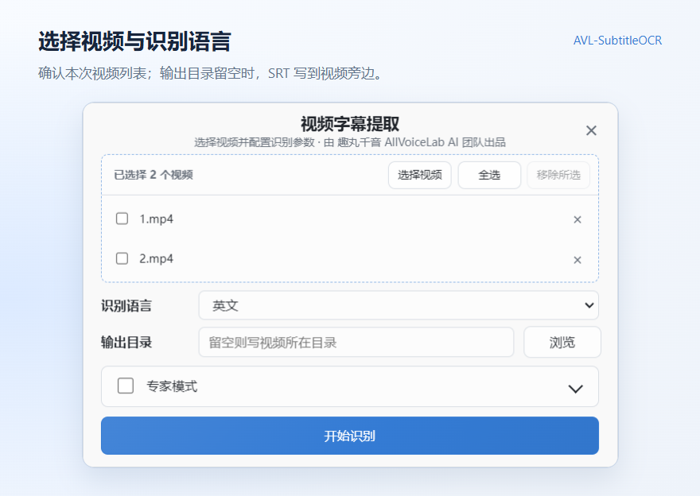
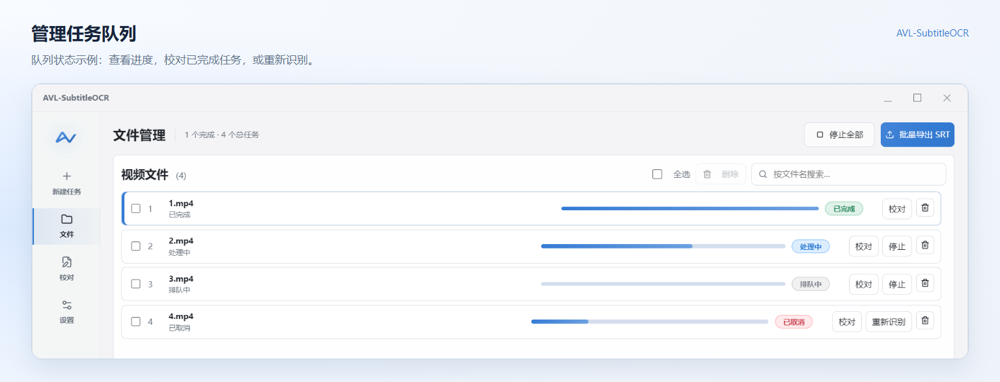
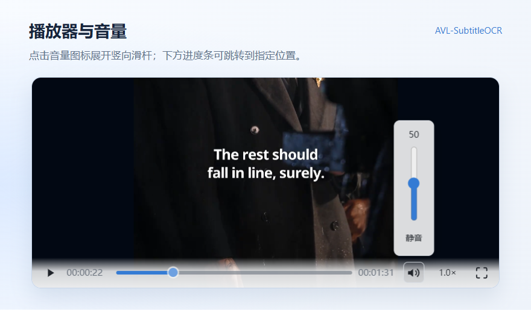
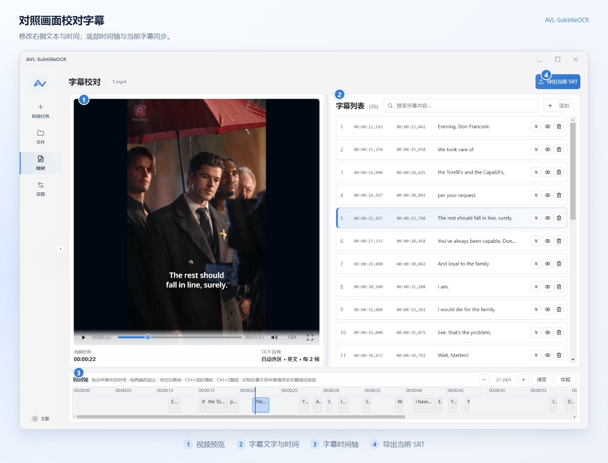
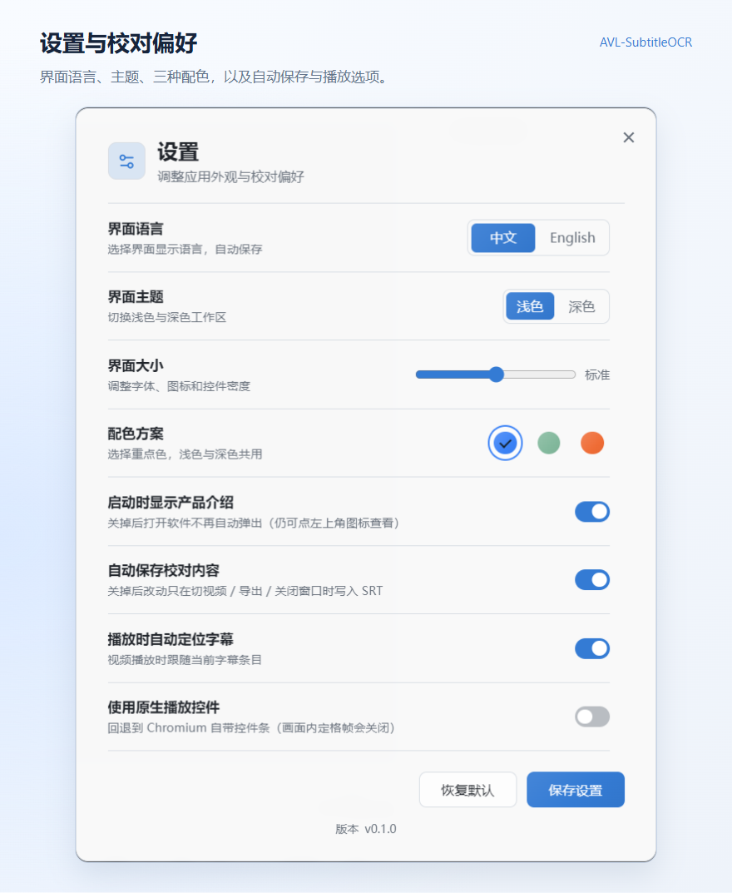
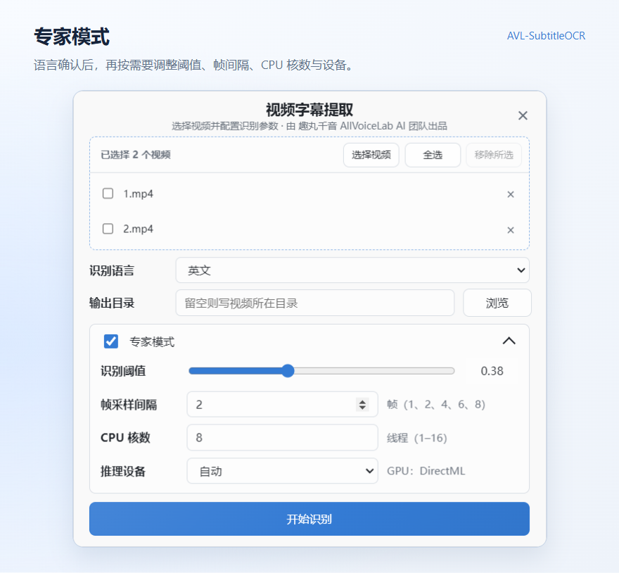

  

<h1 align="center">AVL-SubtitleOCR 使用指南</h1>

  
  

从第一个视频，到一份校对好的 SRT。

  <a href="#日常使用">日常使用</a> · <a href="#专家模式">专家模式</a> · <a href="#常见问题">常见问题</a> · <a href="../README.md">项目介绍</a>

**添加视频 → 选择语言 → 开始识别 → 校对字幕 → 导出 SRT**

识别在本机完成，无需上传视频或联网。本工具适用于已经显示在视频画面中的**硬字幕**，不用于语音转写或提取内嵌字幕轨。

| 你想完成的事情 | 阅读入口 |
| --- | --- |
| 完成第一次识别、校对和导出 | [日常使用](#日常使用) |
| 改善漏字、误识别，或调整速度与电脑占用 | [专家模式](#专家模式) |
| 处理异常、查找日志或反馈问题 | [问题处理与进一步了解](#问题处理与进一步了解) |

指南中的截图使用当前 Windows EXE 的中文界面；[英文版](USER_GUIDE.en.md)配有对应的英文界面截图。

## 日常使用

默认参数可以作为起点。先完成一次识别，确认效果是否符合需求，再决定是否调整。

### 1. 安装与启动

- **系统要求**：Windows 10 / 11，64 位。无需另行安装 Python、CUDA 或 OCR 环境。
- **安装版（Setup）**：双击安装，之后通过桌面或开始菜单快捷方式启动。
- **便携版（Portable）**：双击即可使用，每次启动会先解压，通常比安装版稍慢。

当前版本尚未进行代码签名。若 Windows 弹出 SmartScreen 提示，请确认安装包来源可信，再点击“更多信息 → 仍要运行”。

首次打开会显示产品介绍。关闭后即可开始使用；如不希望每次启动都显示，可在“设置”中关闭“启动时显示产品介绍”。

界面默认中文。在介绍弹窗中点击 **中文 / English** 可即时切换，软件会自动记住选择。之后也可在“设置 → 界面语言”切换；即使关闭启动介绍，仍可从设置调整。界面语言与 OCR 识别语言分别保存，切换界面语言不会改变视频的识别语言或字幕内容。“恢复默认”会将界面语言恢复为中文。

查看首次启动与界面语言切换

### 2. 开始识别

#### 添加视频

进入“新建任务”，将视频拖入选择区域，或点击选择区域。选过视频后，可以点击“选择视频”继续添加。支持一次添加多个视频，也可以继续添加，不会覆盖已选列表。

支持格式：`mp4`、`mov`、`mkv`、`avi`、`webm`。

选错文件时，点击行尾的 `×`，或勾选后点击“移除所选”。这只会移除本次选择，不会删除原视频。

#### 选择语言与输出位置

- **识别语言**：按视频中的字幕语言选择，默认是“中文（简体）”。界面提供 53 个语言选项（含法语、德语的别名），目前已用样本验证中文和英文，其他语言建议先用少量视频试验效果。
- **输出目录**：留空时，SRT 保存到视频所在目录；需要集中存放时，点击“浏览”选择文件夹。
- **专家模式**：可以先保留默认参数；需要调整效果或速度时，参阅后面的[专家模式](#专家模式)。

#### 开始识别

点击“开始识别”，程序会进入“文件”页，按队列处理视频。每一行会显示任务状态、进度和当前阶段。

| 状态 | 含义 |
| --- | --- |
| 待处理 / 排队中 | 尚未开始，或正在等待处理 |
| 处理中 | 正在识别字幕 |
| 已完成 | 识别结束；是否已写入 SRT，以行内输出提示为准 |
| 已修改 | 字幕已校对修改；仍需留意未保存或写盘失败提示 |
| 已取消 / 失败 | 任务已停止或出错，可点击“重新识别” |

首次识别需要加载模型，可能等待几秒到十几秒。

**识别得到字幕后会自动保存为 `视频文件名.srt`，同名 SRT 会被覆盖。** 首次识别未得到字幕时不会新建空 SRT；重新识别未得到字幕时，程序记录的旧 SRT 可能被清空。如需保留旧版本，请先备份。

### 3. 校对字幕

在“文件”页点击视频旁的“校对”。校对页左侧是视频画面，右侧是字幕列表，底部是时间轴。

#### 修改文字与时间

- 点击一条字幕，视频会定位到对应位置并暂停，便于对照画面；眼睛图标也用于定位到该字幕。
- 在文本框中直接修改识别结果。
- 修改起始或结束时间，格式为 `时:分:秒,毫秒`，例如 `00:01:23,500`。程序会限制无效时间及与相邻字幕重叠的范围。
- 在时间轴上拖动字幕块，可整体移动字幕；拖动两端，可分别调整开始或结束时间。
- 点击“添加”插入空字幕；点击“删除”移除字幕，误删后可点击提示中的“撤销”。
- 点击“与下一条合并”，会将时间范围延长到下一条结束，**仅保留当前条文字**。需要下一条文字时，请先复制保留。
- 按 `Ctrl+Z` 撤回上一步校对操作，每个视频支持最近 20 步；关闭程序或重新识别后，撤回记录会清空。

**请等识别完成后再校对。** 识别期间无法保存校对修改，新识别结果也会替换旧字幕。

#### 视频预览

`mp4`、`mov`、`webm` 可直接尝试播放；`mkv`、`avi` 及其他提示需要准备的视频，请先点击“准备预览”。程序会按编码情况重封装或转码为本地 MP4 缓存，转码可能较慢。如果无法播放，可点击“用系统播放器打开”。

点击音量图标会展开竖向音量滑杆；下方进度条可跳转到指定位置。视频与字幕列表中间的分隔条可拖动，按画面与文字的需要调整两栏宽度。

时间轴上的 `−` / `+` 用于缩放，“适应”会将字幕时间范围放进当前窗口，“收起”可暂时折叠时间轴。若识别后看不到字幕块，先点击“适应”。

查看播放器与音量细节

### 4. 保存与导出

默认开启“自动保存校对内容”，修改后约 0.5 秒会写入 SRT。关闭自动保存后，修改会暂存在程序内，在切换视频、导出或关闭窗口时写入。

- **导出单个视频**：在“校对”页点击“导出当前 SRT”。
- **批量导出**：在“文件”页点击“批量导出 SRT”，每个视频生成一个文件。

导出使用当前最新的校对内容，**同名文件会被覆盖**。

如果出现“改动未保存”或“写盘失败，改动只在本程序内”，请确认保存成功后再退出。可关闭占用 SRT 的播放器或编辑器，检查输出目录是否可写、磁盘空间是否充足，再重新导出。

### 5. 批量任务与继续使用

- 运行中加入的视频会排到队尾，使用本轮识别参数。
- 点击单个任务的“停止”，会取消该任务并继续处理下一个；点击“停止全部”，会清空队列。
- 已取消或失败的任务，可点击“重新识别”。
- 同一套参数下，批处理会跳过已完成和已修改的任务；更改识别参数或主动重新识别，可能替换已有校对结果。
- 删除任务只会移除列表记录，不会删除原视频或已经保存的 SRT。

重新打开程序后，会恢复任务列表和上次校对位置，不会自动开始识别。已保存的字幕可以继续校对；如果 SRT 已被删除或无法读取，需要重新识别。

若视频显示“文件不在了”，点击该行的“重新选择”，找到移动或改名后的文件。

### 6. 常用设置与快捷键

“设置”中可调整界面语言、浅色/深色主题、蓝/绿/橙三种配色、界面大小、自动保存及播放时自动定位字幕。配色通过三个圆形色块选择。界面语言切换后立即保存；其他设置调整完成后可点击“保存设置”关闭面板。

当前版本号显示在设置面板底部，反馈问题时可附上这个版本号。

| 快捷键 | 作用 |
| --- | --- |
| `空格` | 播放 / 暂停 |
| `←` / `→` | 后退 / 前进 1 帧 |
| `Shift+←` / `Shift+→` | 后退 / 前进 10 帧 |
| `Home` / `End` | 跳到片头 / 片尾 |
| `[` / `]` | 将当前字幕的起点 / 终点设为播放头位置 |
| `Ctrl+Z` | 撤回上一步校对操作 |
| `Ctrl` + 滚轮 | 缩放时间轴 |
| `Esc` | 取消本次时间轴拖动，或关闭弹窗 |

播放快捷键不会抢占输入框、下拉框或弹窗内的操作。编辑字幕行时，`Ctrl+Z` 仍会撤回校对改动；在其他输入框中则沿用输入框自身的撤销。`Esc` 用于取消拖动或关闭弹窗。分隔条获得焦点时，方向键调整两栏宽度，不会跳转视频帧。

## 专家模式

当你需要减少漏字或误识别、加快批量处理，或控制电脑资源占用时，可以展开“新建任务”中的“专家模式”。建议先确定要解决的问题，再调整对应参数。

### 参数说明

| 参数 | 可选范围 | 默认值 | 主要影响 |
| --- | --- | --- | --- |
| 识别阈值 | 0.05–0.95 | 0.38 | 漏字与误识别之间的取舍 |
| 帧采样间隔 | 1、2、4、6、8 帧 | 2 帧 | 抽帧密度、短字幕覆盖和识别速度 |
| CPU 核数（线程数） | 1–可用逻辑处理器数 | 约一半，最少 1 | CPU 占用与处理速度 |
| 推理设备 | 自动 / CPU / 优先 GPU | 自动 | 使用 CPU 或 GPU 完成推理 |

#### 识别阈值：减少漏字或误识别

阈值越低，识别越宽松，可能减少漏字，也可能增加误识别；阈值越高，识别越保守，可能减少误识别，也可能漏掉字幕。这个数值不代表识别准确率。

从默认值开始小幅调整。例如，漏字较多时可以先试 `0.38 → 0.33`，误识别较多时可以先试 `0.38 → 0.43`，再对照结果决定是否继续。这些数值是试验起点，并非适合所有视频的最佳值。

**阈值按语言分别记忆。** 切换识别语言后，会使用该语言对应的阈值，开始前请再次确认。

#### 帧采样间隔：兼顾速度与短字幕

间隔为 2 帧，表示每隔 2 帧抽取一帧进行识别。间隔越小，抽帧越密；间隔越大，识别通常越快，但短暂出现的字幕可能被跳过。

例如，对 30 fps 的视频，2 帧的理论抽帧间距约为 67 毫秒，8 帧约为 267 毫秒。同样的帧间隔，在不同帧率的视频中对应的时间间距不同。

- 短字幕或字幕切换较快：优先尝试 1–2 帧。
- 字幕停留较久、希望缩短处理时间：先尝试 4 帧，再检查是否漏掉短字幕，必要时继续测试 6 或 8 帧。

#### CPU 核数：给其他工作留出余量

界面中的“CPU 核数”实际控制推理线程数，按可用逻辑处理器数量计算。默认约使用一半，最少 1 个线程；例如有 16 个逻辑处理器时，默认为 8 个线程。未手动修改时，默认值会跟随设备；手动设置后，会保留你选择的数值。

如果识别时还要使用其他程序，可以适当降低核数；如果希望提高处理速度，可以逐步增加，并观察耗时和电脑响应。核数增加不意味着速度一定按比例提升。

#### 推理设备：比较 CPU 与 GPU 的实际表现

- **自动**：有可用 GPU 执行器时优先使用 GPU，否则使用 CPU；当前与“优先 GPU”的选择策略相同。
- **CPU**：固定使用 CPU，可用于比较耗时或排查 GPU 相关问题。
- **优先 GPU**：尝试通过 DirectML 使用 NVIDIA、AMD 或 Intel 显卡；不可用时会自动回落到 CPU。

选择“优先 GPU”不代表本次一定使用了 GPU。请查看任务进度中的实际设备说明，或通过 `sidecar.log` 确认。比较速度时，以同一视频的实际耗时为准。

### 按场景调整

| 你遇到的情况 | 建议先尝试 | 调整后重点检查 |
| --- | --- | --- |
| 漏掉一闪而过的字幕 | 将帧采样间隔从 2 调为 1 | 短字幕是否恢复，处理时间增加多少 |
| 已识别的字幕仍漏字 | 确认语言正确，再小幅降低阈值 | 漏字是否减少，误识别是否增加 |
| 误识别较多 | 小幅提高阈值 | 错误结果是否减少，原有字幕是否被漏掉 |
| 识别结果可接受，但处理时间较长 | 将帧采样间隔从 2 调为 4 | 短字幕和快速切换处是否仍完整 |
| 识别时电脑响应变慢 | 降低 CPU 核数 | 电脑响应是否改善，耗时是否可接受 |
| 想评估显卡加速 | 比较“CPU”与“优先 GPU” | 实际使用的设备及同一视频的处理耗时 |

### 比较结果，再用于批量任务

1. 选一个有代表性的视频，尽量包含清晰字幕、短字幕和容易识别错误的画面。先用默认参数识别，保留 SRT 并记录耗时。
2. 每次只调整一个参数，用同一视频重新识别。比较字幕文字、遗漏情况、时间范围和处理耗时。
3. 找到符合需求的设置后，记录语言、阈值、帧采样间隔、CPU 核数和实际推理设备，再用于字幕风格相近的视频。
4. 更换语言、字幕样式或视频帧率后，先做一次小规模验证，再批量处理。

**重新识别会替换旧字幕，同名 SRT 也会被覆盖。** 比较前，请将已有结果复制到另一个文件夹，尤其是已经人工校对的版本。运行中追加的视频使用本轮参数；测试新参数时，请另开一轮识别。

进一步理解识别过程：预扫描与识别抽帧

程序会自动检测字幕区域，无需手动框选。用于统计字幕区域的“预扫描”与专家模式中的“帧采样间隔”是两个环节：预扫描间隔由程序按视频帧率自动选择，低于 60 fps 为 2 帧，60–不足 120 fps 为 4 帧，120 fps 及以上为 8 帧。

当前界面开放上面的四项参数。字幕区域、预扫描间隔、检测并发和字幕合并的最大间隔由程序自动处理或采用默认值。

如果尝试调整后仍有问题，可记录视频特征、参数、实际设备和前后结果，通过下方的反馈渠道交流。这些信息有助于判断问题出在字幕检测、文字识别还是时间范围。

## 问题处理与进一步了解

### 常见问题

**没有识别出字幕，或漏字较多？**\
先确认视频画面中确实有字幕、识别语言选择正确，再参考[按场景调整](#按场景调整)，逐项尝试阈值或帧采样间隔。

**识别速度慢，或电脑卡顿？**\
需要缩短处理时间时，可尝试增大帧采样间隔或“优先 GPU”；需要改善电脑响应时，可减少 CPU 核数。具体方法见[专家模式](#专家模式)。速度也受视频长度、字幕密度和电脑性能影响。

**点击字幕后看不到对应画面？**\
`mkv`、`avi` 先点击“准备预览”。若开启了“使用原生播放控件”，请关闭该选项，以恢复点击字幕后显示定格画面的功能。

**SRT 保存在哪里？**\
输出目录留空时保存在视频旁边，否则保存在所选目录，文件名为 `视频文件名.srt`。“文件”页会显示已写入的位置。

**任务失败，或长时间没有进展？**\
按错误弹窗中的建议处理，再点击“重新识别”。若提示模型文件缺失，请重新安装；若识别服务退出，可使用弹窗中的“重新连接”。

**为什么首次启动慢？**

后端启动、模型加载和杀毒软件扫描都可能需要一些时间，可以在“文件”页查看当前阶段。

**SRT 写入失败怎么办？**

先关闭可能占用 SRT 的播放器或编辑器，或者换一个有写入权限的输出目录，再重新导出。

### 日志与反馈

更多功能、支持语言和本地数据处理说明，可查看[项目介绍](../README.md)；需要调整识别流程时，可回到[专家模式](#专家模式)逐项试验。

仍无法解决时，请通过[项目 Issues](https://github.com/allvoicelab/AVL-SubtitleOCR/issues) 反馈，并附上版本号、安装方式、Windows 版本、识别语言、专家参数、复现步骤及日志。如果已做过参数对比，也可以附上前后结果和处理耗时。

日志目录：`%APPDATA%\avl-subtitle-ocr\logs\`。其中 `error.log` 记录错误，`sidecar.log` 记录详细运行信息。提交日志和截图前，请隐去用户名、视频名等敏感信息。

### 错误日志与错误码

出现报错时，先查看 `error.log` 中的详细信息。如果界面卡住却没有弹出错误，可以优先查看 `sidecar.log`，其中记录了后端启动、请求、事件和标准错误输出。两个文件都在 `%APPDATA%\avl-subtitle-ocr\logs\` 中。

展开错误码速查

| 错误码 | 含义 |
| --- | --- |
| `E_VIDEO_NOT_FOUND` | 视频被移动、改名或删除 |
| `E_VIDEO_DECODE` | 视频编码不支持或文件损坏 |
| `E_VIDEO_UNSUPPORTED` | 文件不是受支持的视频格式 |
| `E_MODELS_MISSING` | 安装包不完整，模型文件缺失 |
| `E_OUTPUT_WRITE` | SRT 写盘失败 |
| `E_OCR_STALLED` | OCR 长时间无进展 |
| `E_BACKEND_EXITED` | OCR 后端异常退出 |
| `E_TASK_BUSY` | 视频正在识别，暂不能保存校对修改 |
| `E_OCR_RUNTIME` | OCR 引擎运行时错误 |

---

[返回项目介绍](../README.md) · [English guide](USER_GUIDE.en.md) · [回到顶部](#avl-subtitleocr-使用指南)
